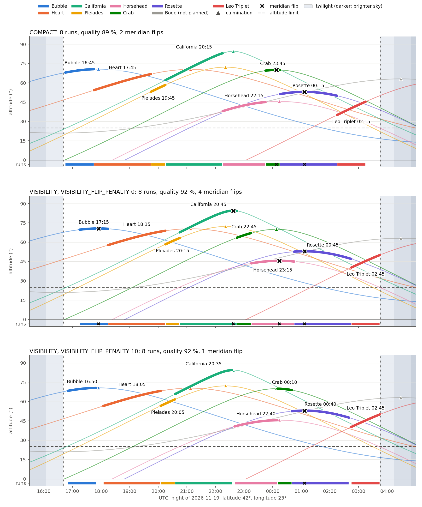
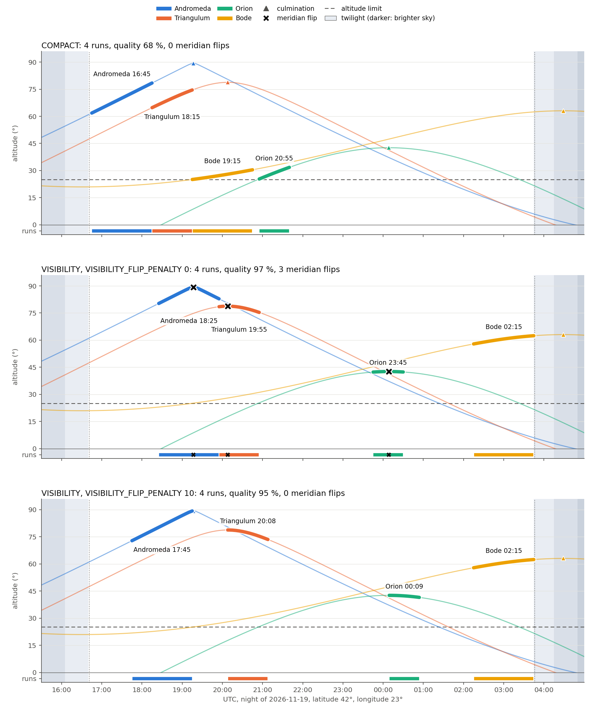

# INDIGO Scheduler Agent - User Guide

Revision: 22.11.2026 (draft)

Author: **Rumen G. Bogdanovski**

e-mail: *rumenastro@gmail.com*

## Quick start

### Introduction

The INDIGO Scheduler Agent runs your imaging tasks unattended. Each task says what to observe, when it may run and how important it is. The scheduler decides which task runs next and when, over as many nights as the tasks need.

[Features](#features) lists what the scheduler can do.

A task is a short text. A few `// @key value` header lines tell the scheduler when and how to run it. An ordinary `Sequencer.js` sequence follows and does the work. The scheduler runs that sequence in the Scripting Agent.

You control the scheduler through the INDIGO properties of the device **Scheduler Agent**. This guide has three parts: a quick start, the concepts with examples, and a reference with the exact rules.

See also: [Sequencer.js](../indigo_drivers/agent_scripting/library/Sequencer.md) for the sequence steps, [SCHEDULER.md](../indigo_drivers/agent_scheduler/doc/SCHEDULER.md) for the design, [PROPERTIES.md](PROPERTIES.md) for the list of all properties.

### Features

**Tasks**

- A task is an ordinary `Sequencer.js` sequence with a few `// @key value` header lines. See [Tasks](#tasks).
- Tasks can be uploaded, reset, disabled, enabled, moved and deleted. See [Managing tasks](#managing-tasks).

**When a task runs**

- A task starts only when all its constraints hold for its whole run. See [Constraints](#constraints).
- The constraints are target altitude, airmass, hour angle, Moon distance, also following the Moon phase, Moon illumination, twilight and time windows, absolute or nightly. Global minimum and maximum altitudes apply to every target. See [Constraints](#constraints).
- Checkpoint steps in the body act at a time, an hour angle or a target altitude. They skip to the next `resume_point()`, or end the sequence when none follows. See [Constraints](#constraints).
- The duration of a run comes from `@duration`, from the last successful run or from an estimate of the sequence. See [Task duration](#task-duration).
- Every task has a priority class, `low`, `normal`, `high` or `urgent`, and a level. Within a class, a score adds bonuses for setting targets and for targets near culmination. See [Priorities](#priorities).
- Two strategies: `COMPACT` starts the best task at once, `VISIBILITY` plans the night so that targets run close to their culmination. See [Choosing a strategy](#choosing-a-strategy).
- The night plan shows the expected runs and hooks for the rest of the night, and the tasks that will not run tonight with the reason. See [The night plan](#the-night-plan).
- The night plan takes meridian flips into account, and `VISIBILITY` avoids short flips. See [Meridian flips](#meridian-flips).

**Runs**

- Repeats with a pause between the runs, retries after a failure with a delay, and a history of every finished run. See [Repeats, retries and the history](#repeats-retries-and-the-history).
- An urgent task, such as a new supernova, interrupts the running task. `@preempted` decides whether the interrupted task runs again or fails. See [Urgent tasks](#urgent-tasks).

**Equipment and the night**

- Hooks prepare and put away the equipment: `STARTUP` and `SHUTDOWN` for the session, `NIGHT_START` and `NIGHT_END` for every scheduler night with work, `IDLE` after `IDLE_HOOK_DELAY` minutes without a task start, and `RESUME` before the next task after `IDLE` or `NIGHT_END`. See [Hooks and the night](#hooks-and-the-night).
- Weather and safety: the unsafe hold aborts the running task and runs the `UNSAFE` hook. When the conditions have been safe for `SAFE_DELAY` minutes, the hold ends and, during a scheduler night with work, the `SAFE` hook runs. It needs the Auxiliary Agent. See [Unsafe conditions](#unsafe-conditions).

**Data**

- The frames carry the task as the object name and in the FITS keywords `SCHTASK`, `SCHRUN` and `SCHNIGHT`, with `OBSERVER`, `PI_NAME` and `PROPID` and a folder per task if you ask. See [Where the data goes](#where-the-data-goes).

**State and restarts**

- The scheduler shows its state, the current task, the reason why nothing runs, and a message for every event. See [Scheduler state](#scheduler-state), [Reasons](#reasons) and [Messages](#messages).
- The scheduler works over as many nights as the tasks need. The tasks, their states, the settings and the history survive a server restart. See [Starting, stopping and restarting](#starting-stopping-and-restarting) and [What happens when the server restarts](#what-happens-when-the-server-restarts).

### What you need

- **The Scripting Agent.** It runs every task. Without it, no task starts.
- **The Mount Agent.** It gives the scheduler the site coordinates. Tasks with a target or a twilight limit need them, and so do the night hooks.
- **The Auxiliary Agent, for weather and safety.** It gives the scheduler the safety signal for the unsafe hold and the `UNSAFE` and `SAFE` hooks. Without it there is no safety information, and `AGENT_SCHEDULER_SAFETY_MISSING` decides. See [Unsafe conditions](#unsafe-conditions).
- **These agents on the same server as the Scheduler Agent.** The scheduler finds them by their exact names.
- **The site, set in the Mount Agent.** For example:

  ```
  indigo_prop_tool set "Mount Agent.GEOGRAPHIC_COORDINATES.LATITUDE=42.7;LONGITUDE=23.3;ELEVATION=550"
  ```

- **The agents your tasks use**, such as the Imager and Guider Agents and a plate solver agent, set up as for any sequence. The scheduler does not check them. A task that needs a missing agent fails when it runs.

> **Note:** All times that the scheduler accepts or shows are in UTC. This includes `@window`, the night plan and the history.

Details: [Agents the scheduler depends on](#agents-the-scheduler-depends-on). See also: [native INDIGO solver reference](../indigo_drivers/agent_platesolver/doc/PLATESOLVER.md) for the Platesolver Agent that sequences use.

### Loading the agents

Name the agents when you start the server:

```
indigo_server indigo_agent_scripting indigo_agent_mount indigo_agent_scheduler
```

Or load them into a running server, one driver per command:

```
indigo_prop_tool set "Server.LOAD.DRIVER=indigo_agent_scripting"
indigo_prop_tool set "Server.LOAD.DRIVER=indigo_agent_mount"
indigo_prop_tool set "Server.LOAD.DRIVER=indigo_agent_scheduler"
```

Add `indigo_agent_imager`, `indigo_agent_guider` and a plate solver agent for tasks that capture, guide or solve. Add `indigo_agent_auxiliary` for the weather and safety.

### How to talk to the scheduler

You can use the dedicated scheduler windows of the INDIGO clients. They show the task list, the night plan, the history and the messages. A generic property editor may edit text in a single line only. Upload tasks with `indigo_prop_tool` in that case.

The examples in this guide use `indigo_prop_tool`, which can do everything:

- **Upload a task file** with `set_script`. It sends the content of the file as the `TASK` item:

  ```
  indigo_prop_tool set_script "Scheduler Agent.AGENT_SCHEDULER_ADD_TASK.TASK=m31.task"
  ```

- **Set short values** with `set`. It splits values at `;`, so it cannot send a task. `ITEM=` or `ITEM=""` sends an empty value. This clears a text item, such as a hook.
- **Read values** with `get`. It prints light items as `ON` or `OFF`, or with `-e` as their state, but never their text.
- **Read the task list, the night plan and the history** with `list -e`. It prints the label of each item after `  # `, and the state of each light as `IDLE`, `OK`, `BUSY` or `ALERT`:

  ```
  indigo_prop_tool list -e "Scheduler Agent.AGENT_SCHEDULER_HISTORY"
  ```

  ```
  Scheduler Agent.AGENT_SCHEDULER_HISTORY.RUN_1 = OK  # 2026-11-20 20:02-20:02 | Test | run 1 | task | SUCCEEDED | -
  ```
- **Reach a remote server** with `-r host` after the command word, for example `indigo_prop_tool get -r host ...`. Options before the command word are not recognised.
- **See the result** with `-s`. It prints the state of the property you change: `[OK]` for an accepted upload, `[ALERT]` for a rejected one.

`indigo_prop_tool` also prints the messages of the Scheduler Agent that answer your change, such as the reason of a rejection.

### A first task in five minutes

This walk-through needs only the Scheduler and Scripting Agents. The test task waits ten seconds and uses no equipment.

1. Save this task as `test.task`:

   ```js
   // @task Test
   // @duration 1

   var sequence = new Sequence(scheduler_task.name);
   sequence.wait(10);
   sequence.start();
   ```

2. Upload it:

   ```
   indigo_prop_tool set_script -s "Scheduler Agent.AGENT_SCHEDULER_ADD_TASK.TASK=test.task"
   ```

   An accepted upload ends with `[OK]`. A rejected one ends with `[ALERT]` and a message that names the problem, for example `Scheduler Agent: Task rejected: line 2: @bogus: unknown key`.

   The task appears in the task list `AGENT_SCHEDULER_TASK_STATE` as `Test | QUEUED | normal 50 | run 0/1 | retries left 0 | 0h01 set`. `indigo_prop_tool list -e "Scheduler Agent.AGENT_SCHEDULER_TASK_STATE"` shows it. The last column is the duration and where it comes from. `set` means that it comes from `@duration`. The task also gets its own property, `AGENT_SCHEDULER_TASK_0`.

3. Start the scheduler:

   ```
   indigo_prop_tool set "Scheduler Agent.AGENT_SCHEDULER_CONTROL.START=ON"
   ```

4. Follow it. Repeat this command to see the progress:

   ```
   indigo_prop_tool get "Scheduler Agent.AGENT_SCHEDULER_CURRENT.CURRENT;REASON"
   ```

   While the task runs, `CURRENT` is `Test`. Ten seconds later the task is `DONE`. Nothing is left to do, so the scheduler stops by itself with the message `All tasks finished, the scheduler stopped`.

   The history `AGENT_SCHEDULER_HISTORY` now has the run. Show it with:

   ```
   indigo_prop_tool list -e "Scheduler Agent.AGENT_SCHEDULER_HISTORY"
   ```

   The run is its last item, for example:

   ```
   Scheduler Agent.AGENT_SCHEDULER_HISTORY.RUN_1 = OK  # 2026-11-20 20:02-20:02 | Test | run 1 | task | SUCCEEDED | -
   ```

5. Remove the task:

   ```
   indigo_prop_tool set "Scheduler Agent.AGENT_SCHEDULER_DELETE_TASK.NAME=Test"
   ```

## Concepts

### Tasks

A task tells the scheduler what to do and when it may do it. Here is a complete task:

```js
// @task       M31 LRGB
// @priority   normal 60
// @target     00:42:44.3 +41:16:09
// @altitude   > 30
// @moon       > 40 width 7
// @twilight   astronomical
// @repeat     2 every 30
// @retry      1 after 15

var sequence = new Sequence(scheduler_task.name);
sequence.precise_goto(5, scheduler_task.ra, scheduler_task.dec);
sequence.start_guiding();
sequence.select_filter("L");
sequence.capture_batch(20, 300);
sequence.stop_guiding();
sequence.start();
```

A task has two parts:

- The **header** is the block of `// @key value` lines at the top. It says when and how the task may run. It ends at the first line that is not a header line, here the blank line.
- The **body** is everything after the header. It is a normal `Sequencer.js` sequence that ends with `sequence.start()`.

The header lines are comments, so the whole task is valid JavaScript. Only `@task`, the name, is required. Keys and their words, such as `high` or `astronomical`, are not case-sensitive. Each key may appear only once.

> **Note:** A `// @key` line after the end of the header belongs to the body. The scheduler ignores it. Keep all header lines together at the top.

**The `scheduler_task` object.** Before the body runs, the scheduler defines a `scheduler_task` object from the header. The body then does not have to repeat the name or the coordinates.

| Field | Meaning |
|---|---|
| `scheduler_task.name` | The task name from `@task`. Name the sequence after it, as in `new Sequence(scheduler_task.name)` |
| `scheduler_task.ra`, `scheduler_task.dec` | The `@target` coordinates, RA in hours and Dec in degrees, J2000. Defined only with `@target` |
| `scheduler_task.run` | The number of this run, starting at 1 |
| `scheduler_task.estimate` | Defined only while the scheduler estimates the duration |
| `scheduler_task.token` | An internal identifier of the run |

**Uploading a task.** Keep each task in a text file, for example `m31.task`, and write it to the `TASK` item of `AGENT_SCHEDULER_ADD_TASK`:

```
indigo_prop_tool set_script -s "Scheduler Agent.AGENT_SCHEDULER_ADD_TASK.TASK=m31.task"
```

The task name comes from `@task`, not from the file name. On upload, three things happen:

1. **The scheduler checks the header.** A wrong header rejects the upload, and nothing is stored. A message names the problem, for example `Task rejected: line 4: @altitude: expected '> degrees' with degrees 0-90`.
2. **The scheduler stores the task.** The task gets a line in the task list and its own property `AGENT_SCHEDULER_TASK_<n>`.
3. **The scheduler estimates the duration.** An error in the body, even a syntax error, marks the task `SCRIPT ERROR`. The task does not run until you fix it.

Details: [Header syntax](#header-syntax), [Header keys](#header-keys), [Rules for the body](#rules-for-the-body), [Managing tasks](#managing-tasks).

### Constraints

Constraints are header keys that limit when a task can run. The basic rule is simple: **a task starts only if it can finish.** All its constraints must hold from the moment it would start until the moment it would end.

```js
// @target     05:35:17 -05:23:28
// @altitude   > 30
// @twilight   astronomical
// @duration   180
```

Suppose this target sinks below 30° two hours from now. The three-hour run cannot finish above the limit, so the task waits for a later time.

**The constraint keys:**

- `@altitude > 30` keeps the target at least 30° high. A target must always be above the horizon.
- `@airmass < 2` keeps the airmass below 2.
- `@ha -2 .. 2` keeps the target within two hours of the meridian.
- `@moon > 40` keeps the target at least 40° from the Moon.
- `@illumination < 50` requires that less than half of the Moon is lit.
- `@twilight astronomical` requires darkness, with the Sun below −18°. A task without `@twilight` may also run in daylight.
- `@window` limits the time, in UTC.

The Moon keys apply only while the Moon is above the horizon.

**Global altitude limits.** Two settings limit the altitude of every task with `@target`: `MIN_ALTITUDE` (default 20°) and `MAX_ALTITUDE` (default 90°, no ceiling). The target must stay at or above the larger of `MIN_ALTITUDE` and the task's own `@altitude`, and at or below `MAX_ALTITUDE`, for the whole run. `@altitude` therefore only matters when it is higher than `MIN_ALTITUDE`. `MAX_ALTITUDE` keeps the targets out of the zenith blind spot of an alt-az or fork mount, or below the edge of a roof or dome opening. Tasks without `@target` are not affected. Like `@altitude`, the limits only rule out times: a running task is not interrupted, and the visibility quality is still measured against the culmination.

The default `MIN_ALTITUDE` of 20° holds every target with a lower `@altitude`, or without one, at 20°. Set `MIN_ALTITUDE` to 0 to let such tasks run down to their own `@altitude` or to the horizon.

A task whose target can never stand within the limits shows `UNREACHABLE`. This happens when `MAX_ALTITUDE` is not above the task's `@altitude`, when the target culminates below the effective minimum, or when a circumpolar target never sinks below `MAX_ALTITUDE`. A message says why, for example `Task 'M31' can never run: the target culminates at 15.3°, below the minimum altitude 20°`. The task is skipped until a change of the limits, the site or the task makes it reachable again. A target that never rises at all is reported as `never rises above the horizon`. A hook task is never marked: hooks ignore the sky constraints.

**Time windows.** A window has a start, an end, or both:

```
// @window 2026-11-20 21:00 .. 2026-11-21 02:30     absolute, UTC
// @window 2026-11-20 21:00 ..                      from a time on
// @window .. 2026-11-21 02:30                      until a time
// @window 22:00 .. 03:00                           every night, across midnight
```

- A window with dates is **absolute**. When its end has passed, the task expires and never runs again.
- A window with times only is **nightly**. It repeats every day and never expires.
- The whole run must fit in the window.

**Moon avoidance that follows the phase.** With `width`, the Moon distance shrinks as the Moon gets darker:

```
// @moon > 40 width 7
```

The full 40° applies at full moon. `width 7` halves the limit seven days from full moon, to 20°. At new moon it is about 7°. A small width suits narrowband imaging, which tolerates moonlight. A large width keeps the limit high for most of the month.

**The duration is a forecast, not a limit.** The scheduler never stops a run that takes longer than expected. A task with `@duration 10` whose sequence needs 25 minutes runs for 25 minutes. A target that sets or a window that ends during a run does not stop it either. A run stops only when its sequence ends, when you abort or delete it, or when an urgent task interrupts it.

To keep a run within a limit, use the checkpoint steps of the sequencer in the body:

- `break_at(time)` acts once `time` has passed;
- `break_at_ha(limit)` acts once the hour angle is past `limit`;
- `break_if_target_altitude_below(...)` acts once the target sinks below an altitude.

Each of them skips to the next `resume_point()`, or ends the sequence when none follows. A time string in `break_at()` is UTC.

```js
// @task       M31 until 02:00
// @target     00:42:44.3 +41:16:09
// @duration   120

var sequence = new Sequence(scheduler_task.name);
sequence.precise_goto(5, scheduler_task.ra, scheduler_task.dec);
sequence.select_filter("L");
sequence.repeat(24, function() {
	sequence.break_at("02:00");
	sequence.capture_batch(1, 300);
});
sequence.resume_point();
sequence.start();
```

A checkpoint acts only where the sequence reaches it, so an exposure in progress finishes first. A run that ends through a checkpoint counts as a successful run.

Details: [Constraint rules](#constraint-rules), [Duration rules](#duration-rules).

### Task duration

The scheduler needs to know how long a run takes, to check the constraints and to plan the night. It takes the first available of these sources:

1. **`set`**: `@duration` in the header, in minutes.
2. **`measured`**: the real length of the last successful run.
3. **`estimated`**: an estimate computed from the sequence.
4. **`default`**: 60 minutes.

The task list shows the duration with its source, for example `1h52 estimated`.

**The estimate.** After an upload or an edit, the scheduler runs the body once. `sequence.start()` then only counts the steps. The estimate adds the exposure times, the fixed waits and an overhead per frame and per operation, such as a slew. A step with no known length, such as `wait_until()`, prevents the estimate.

**The measurement.** After every successful run, the scheduler remembers how long it really took. This includes meridian flips and slow downloads.

Set `@duration` when you know the time a task needs, or when the sequence cannot be estimated.

> **Note:** While the scheduler estimates the duration of a task waiting to run, only an urgent task can start. `REASON` may then show `estimating the task duration`. An estimate takes a few seconds after an upload or an edit.

Details: [Duration rules](#duration-rules).

### Priorities

The priority decides which task starts when several tasks can run at the same moment.

```
// @priority high 80
```

A priority has two parts:

- the **class**: `low`, `normal`, `high` or `urgent`;
- the **level**: a number from 0 to 100.

A task without `@priority` is `normal 50`. A class without a level, such as `@priority high`, gets level 50.

**The class decides first.** Any `high` task wins over any `normal` task. Any `normal` task wins over any `low` task.

**Within a class, the score decides.** The score is the level plus two bonuses. Both bonuses depend on where the task stands in the sky now.

- The **setting bonus** is largest for a task whose constraints will stop holding soonest. Examples are a target that is about to set and a window that is about to close.
- The **altitude bonus** is largest for a target at its culmination. It compares the target's altitude now with the highest altitude that target reaches at your site. A low southern target at culmination therefore gets the same bonus as a high northern target at culmination.

A task without `@target` gets no altitude bonus.

**Example.** Two `normal` tasks can run at 21:00. Task A is `normal 60` and its target stays up all night. Task B is `normal 40`, and its target is near culmination and sets in an hour. Task B has the higher score and starts first.

With the default settings, each bonus adds at most 100 points. The two bonuses together can outweigh the whole level range. You can change this with two settings:

- Set `SETTING_WEIGHT` and `ALTITUDE_WEIGHT` to 0, and the level alone decides within a class.
- Raise them, up to 4, and the sky position counts more.

Even at the highest weights, the bonuses never lift a task into a higher class.

**Equal scores.** When two tasks have the same score, the task higher in the task list wins. `MOVE_UP` and `MOVE_DOWN` change the list order.

**A bonus is not a condition.** Bonuses only rank the tasks that can run now. A task with no bonus still starts when it has the best score, or when it is the only task that can run. Only the constraints decide whether a task can run.

**Urgent tasks.** The class `urgent` works differently. The level of an urgent task is ignored.

- An urgent task starts before every other task, as soon as its constraints hold.
- It interrupts a running task that is not urgent.
- Urgent tasks never interrupt each other. They start in the order you submitted them.

**A running task is not interrupted** for a task with a better score. Only an urgent task interrupts a run.

**Hook tasks.** The class `hook` marks a task that only a hook runs. Hooks are tasks that run at fixed moments, such as the start of the night. A hook task has no level and no score.

Details: [Score rules](#score-rules), [Urgent task rules](#urgent-task-rules), [Hook rules](#hook-rules).

### How the next task is chosen

The scheduler decides what to start each time nothing runs:

- when a run ends;
- when you change a task, a setting or the strategy;
- every `IDLE_CHECK_INTERVAL` seconds while it waits.

Each decision has four steps.

1. **Find the tasks that can run now.** A task can run now when all its constraints hold from now until the end of its run. Example: a one-hour run on a target with `@altitude > 30`. If the target sinks below 30° after twenty minutes, the task cannot run now. It shows `WAITING` in the task list.
2. **Start an urgent task, if one can run.** When several urgent tasks can run, the one submitted first starts.
3. **Rank the other tasks.** The class decides first, then the score.
4. **Start the best task.** When it starts depends on the strategy:
   - With `COMPACT`, the default, it starts now.
   - With `VISIBILITY`, the scheduler follows its night plan. The next planned run may start later. Until then, `REASON` names the run and its start time.

When no task can run, `REASON` shows why. It gives the reason of the first waiting task in the task list. After `IDLE_HOOK_DELAY` minutes without a task start, the `IDLE` hook runs.

The night plan uses the same steps for the rest of the night. It therefore shows the order and the times the scheduler will follow.

See also: [Choosing a strategy](#choosing-a-strategy), [The night plan](#the-night-plan), [Hooks and the night](#hooks-and-the-night).

### Choosing a strategy

`AGENT_SCHEDULER_STRATEGY` decides how the scheduler uses the night. INDIGO clients show `VISIBILITY` as "Best visibility".

- **`COMPACT`** starts the best task as soon as it can run. This is the default. The night fills from dusk, and the equipment is never idle while a task could run. `COMPACT` does not look ahead. With a short queue, all tasks run from dusk, even when a target would stand much higher later.
- **`VISIBILITY`** plans the whole night first. It starts from the runs that `COMPACT` would make. Then it adds runs that `COMPACT` leaves out, where they still fit. Finally it moves the runs to the times when their targets stand highest. The plan may wait when waiting gives a better night.

```
indigo_prop_tool set "Scheduler Agent.AGENT_SCHEDULER_STRATEGY.VISIBILITY=ON"
indigo_prop_tool set "Scheduler Agent.AGENT_SCHEDULER_STRATEGY.COMPACT=ON"
```

**How each strategy uses priority.**

- `COMPACT` uses priority at every start. It starts the task with the best class and score among the tasks that can run then. A `normal` task can therefore start before a `high` task whose constraints do not hold yet.
- `VISIBILITY` uses priority only to choose which runs get into the plan. It starts from the runs `COMPACT` would make and never plans fewer. It then places the runs by when their targets stand highest, not by priority. A `high` task may therefore run after a `normal` one.
- Urgent tasks are never moved. They keep their `COMPACT` times in the plan, and they start at once when they can.

**The quality of a run** is the mean altitude of the target during the run, in percent of its culmination altitude. A run centred on the culmination has 100 %. `VISIBILITY` makes the sum of the qualities as large as it can, each weighted by the length of its run. Two hours at 95 % therefore count more than twenty minutes at 99 %. A task without `@target` has no quality. It runs as early as the plan has room for it.

The constraints stay hard limits under `VISIBILITY`. `@altitude` only rules out times. It does not change the quality, which is always measured against the culmination.

**Example.** The site is at 42° N, 23° E, on the night of 19 November 2026. Astronomical dusk is at 16:45 UTC. Six tasks have `@twilight astronomical`. Pleiades and Soul have `@altitude > 10`, the others `@altitude > 20`. Orion has `@priority high`. The meridian flip is disabled.

| Task | Length | Culmination (UTC) | `COMPACT` | Quality | `VISIBILITY` | Quality |
|---|---|---|---|---|---|---|
| Elephant | 121 min | 16:08 | 16:45–18:46 | 91 % | 16:45–18:46 | 91 % |
| Soul | 28 min | 21:25 | 18:46–19:14 | 85 % | 21:15–21:43 | 100 % |
| Pleiades | 21 min | 22:21 | 19:14–19:35 | 67 % | 22:10–22:31 | 100 % |
| Jellyfish | 121 min | 00:50 | 19:35–21:36 | 48 % | 23:51–01:52 | 98 % |
| Orion | 31 min | 00:08 | 21:36–22:07 | 78 % | 23:20–23:51 | 98 % |
| Rosette | 21 min | 01:06 | 22:07–22:28 | 69 % | 01:52–02:13 | 96 % |
| Mean | | | | 73 % | | 97 % |

With `COMPACT`, everything runs from dusk. Jellyfish runs more than three hours before its culmination, at less than half of its best altitude. The equipment is idle after 22:28. With `VISIBILITY`, every task still runs once, each close to its culmination. Elephant stays at dusk, where it stands highest tonight.

**Meridian flips in the example.** A German equatorial mount must flip when a run crosses the meridian. `OFFSET` is the flip point that `enable_meridian_flip()` sets. With 0, the mount flips at the meridian. Under `VISIBILITY`, `VISIBILITY_FLIP_PENALTY` makes the planner count each flip as lost imaging time, so the plan moves short runs to one side of the meridian. `COMPACT` ignores the penalty.

With the flip enabled and `VISIBILITY_FLIP_PENALTY` 0, the plan is the same as in the table. With the flip enabled at `OFFSET` 0 and the default penalty, Soul, Pleiades and Jellyfish start just after the meridian, and no run flips.

**What you see during a wait.** The tasks stay `QUEUED`. `REASON` names the next planned run, for example `Soul starts at 21:15 UTC, planned for better visibility`. Switching to `COMPACT` during a wait starts the best task at once.

**When to use which.**

- Use `COMPACT` for a queue that fills the night, for many short tasks, or when you prefer data early in an uncertain night.
- Use `VISIBILITY` for a queue shorter than the night. When the queue fills the night, both strategies give nearly the same plan.

> **Warning:** Under `VISIBILITY` the scheduler may wait long for a planned run. If your `IDLE` hook parks the mount or closes the dome, choose `IDLE_HOOK_DELAY` long enough. With a short delay, even a short wait parks and unparks the mount.

See also: [Two nights compared](#two-nights-compared), [Meridian flips](#meridian-flips). Details: [Strategy rules](#strategy-rules).

### Two nights compared

The two nights below compare three settings: `COMPACT`, `VISIBILITY` with `VISIBILITY_FLIP_PENALTY` 0, and `VISIBILITY` with the default penalty of 10 minutes. All three have the meridian flip enabled at `OFFSET` 0. The site and the date are those of the previous example. Astronomical dusk is at 16:45 UTC and dawn at 03:50 UTC, which gives 665 dark minutes. Every task has `@twilight astronomical` and `@altitude > 25`. The plans come from the scheduler's own planning code.

**How to read the charts.** Each panel is one setting. The thin curves are the target altitudes, and the triangles mark the culminations. The dashed line is the altitude limit, the shaded bands are twilight, and the dotted lines are dusk and dawn. A thick stretch of a curve is a planned run. The `runs` strip above the time axis shows when each run happens. A cross marks a meridian flip. The quality of a night is the mean quality of its runs, each weighted by its length.

**A busy night.** Nine tasks need 750 minutes, more than the 665 dark minutes. Horsehead has `@priority high`. Heart, California and Pleiades culminate between 21:00 and 22:40. Crab, Horsehead and Rosette culminate between 00:00 and 01:10.



| Target | Length | Culmination (UTC) | `COMPACT` | `VISIBILITY`, penalty 0 | `VISIBILITY`, penalty 10 |
|---|---|---|---|---|---|
| Bubble | 60 min | 17:54 | 16:45–17:45, 98 % | 17:15–18:15, 100 %, flip | 16:50–17:50, 99 % |
| Heart | 120 min | 21:07 | 17:45–19:45, 86 % | 18:15–20:15, 91 % | 18:05–20:05, 89 % |
| Pleiades | 30 min | 22:21 | 19:45–20:15, 77 % | 20:15–20:45, 84 % | 20:05–20:35, 82 % |
| California | 120 min | 22:37 | 20:15–22:15, 86 % | 20:45–22:45, 92 %, flip | 20:35–22:35, 90 % |
| Horsehead (high) | 90 min | 00:14 | 22:15–23:45, 92 % | 23:15–00:45, 99 %, flip | 22:40–00:10, 96 % |
| Crab | 30 min | 00:08 | 23:45–00:15, 100 %, flip | 22:45–23:15, 93 % | 00:10–00:40, 99 % |
| Rosette | 120 min | 01:06 | 00:15–02:15, 98 %, flip | 00:45–02:45, 97 %, flip | 00:40–02:40, 97 %, flip |
| Leo Triplet | 60 min | after dawn | 02:15–03:15, 66 % | 02:45–03:45, 74 % | 02:45–03:45, 74 % |
| Bode | 120 min | 04:28 | not planned | not planned | not planned |
| Night | | | 8 runs, 89 %, 2 flips | 8 runs, 92 %, 4 flips | 8 runs, 92 %, 1 flip |

- **`COMPACT`** fills the night from dusk without a gap. When Rosette ends at 02:15, only 95 dark minutes are left. That is too little for the 120 minutes of Bode, so Leo Triplet runs low in the east. Crab and Rosette happen to cross the meridian.
- **`VISIBILITY` with penalty 0** keeps the same eight runs. Bode fits nowhere, because the other runs take 630 of the 665 minutes. The 35 spare minutes let it shift and reorder the runs. Waiting half an hour after dusk centres Bubble on its culmination, and every later run starts later. Crab moves before Horsehead, so a high-priority run comes after a normal one. The quality rises from 89 % to 92 %. The price is four flips, because a run centred on its culmination crosses the meridian.
- **`VISIBILITY` with penalty 10** makes almost the same night without the short flips. Bubble, California and Horsehead end before the meridian, and Crab starts just after it. Only the 120-minute Rosette keeps its flip, because moving it would cost more than ten minutes of full-quality imaging. One flip instead of four costs less than one percentage point of quality.

When the queue fills the night, `VISIBILITY` only fine-tunes the times. The flip penalty matters more here than the strategy.

**A sparse night.** Four tasks need 285 minutes, less than half of the night.



| Target | Length | Culmination (UTC) | `COMPACT` | `VISIBILITY`, penalty 0 | `VISIBILITY`, penalty 10 |
|---|---|---|---|---|---|
| Andromeda | 90 min | 19:16 | 16:45–18:15, 78 % | 18:25–19:55, 96 %, flip | 17:45–19:15, 91 % |
| Triangulum | 60 min | 20:07 | 18:15–19:15, 89 % | 19:55–20:55, 99 %, flip | 20:08–21:08, 98 % |
| Bode | 90 min | 04:28 | 19:15–20:45, 44 % | 02:15–03:45, 96 % | 02:15–03:45, 96 % |
| Orion | 45 min | 00:08 | 20:55–21:40, 67 % | 23:45–00:30, 100 %, flip | 00:09–00:54, 99 % |
| Night | | | 4 runs, 68 %, no flip | 4 runs, 97 %, 3 flips | 4 runs, 95 %, no flip |

- **`COMPACT`** runs every task as soon as it can. Bode starts at 19:15, when it climbs above 25°, nine hours before its culmination. After 21:40 the equipment is idle for the rest of the night.
- **`VISIBILITY` with penalty 0** waits for each target. Andromeda, Triangulum and Orion are centred on their culminations. Bode runs at the end of the night, as high as it gets before dawn. The quality rises from 68 % to 97 %, but three runs cross the meridian.
- **`VISIBILITY` with penalty 10** keeps the waits and moves each short run to one side of the meridian. Bode keeps its time, because its run ends before its culmination and does not flip. Three flips are avoided for two percentage points of quality.

### The night plan

The night plan `AGENT_SCHEDULER_PLAN` shows what the scheduler expects to do for the rest of the night. It has one item per planned run, in order:

```
2026-11-20 20:14-20:44 | SN 2026abc | run 1/1 | urgent | PLANNED | -
2026-11-20 20:44-22:36 | M31 LRGB | run 1/2 | normal 60 | PLANNED | -
2026-11-20 23:36-01:28 | M31 LRGB | run 2/2 | normal 60 | PLANNED | -
2026-11-21 01:45-02:45 | M81 | run 1/1 | normal 50 | PLANNED | -
2026-11-21 05:10-05:12 | Morning | - | hook night end | PLANNED | -
- | M42 | run 0/1 | normal 50 | NOT TONIGHT | target below the altitude limit
- | NGC 891 | run 0/1 | normal 50 | NOT TONIGHT | disabled
- | NGC 253 | run 0/1 | normal 50 | UNREACHABLE | culminates at 16.7°, below the minimum altitude 20°
```

Each run shows its expected start and end in UTC, the task, the run number and the priority. The night hooks appear at their expected times, such as `Morning` above. A gap between two runs is idle time. With `COMPACT`, nothing can run in the gap. With `VISIBILITY`, the plan waits there for a better time. At the end come the tasks that will not run tonight, with the reason.

**The plan is a forecast.** It assumes that every run succeeds and takes its expected duration. It cannot show where an urgent task will interrupt a run. During the day the plan shows the coming night. While the scheduler is stopped, it shows the plan that `START` would follow.

Details: [Night plan items](#night-plan-items).

### Hooks and the night

Hooks are tasks that the scheduler runs at fixed moments, to prepare the equipment and to put it away. You write a hook task like any other task and name it in an item of `AGENT_SCHEDULER_HOOKS`:

| Item | When its task runs |
|---|---|
| `STARTUP` | On `START`, before the first task |
| `SHUTDOWN` | When the scheduler stops |
| `NIGHT_START` | When a scheduler night with work starts |
| `NIGHT_END` | When that scheduler night ends |
| `IDLE` | Once, after `IDLE_HOOK_DELAY` minutes without a task start |
| `RESUME` | Before the next task after `IDLE` or `NIGHT_END` |
| `UNSAFE` | Once, when the conditions become unsafe, see [Unsafe conditions](#unsafe-conditions) |
| `SAFE` | When the conditions are safe again during a night with work |

**Example: park while waiting.** Three short tasks unpark and park the mount. `Startup` also sets the meridian flip for all tasks:

```js
// @task Startup

var sequence = new Sequence(scheduler_task.name);
sequence.unpark();
sequence.enable_meridian_flip(true, 0);
sequence.start();
```

```js
// @task Unpark

var sequence = new Sequence(scheduler_task.name);
sequence.unpark();
sequence.start();
```

```js
// @task Park

var sequence = new Sequence(scheduler_task.name);
sequence.park();
sequence.start();
```

Save them as `startup.task`, `unpark.task` and `park.task`. Upload them and name them as hooks:

```
indigo_prop_tool set_script "Scheduler Agent.AGENT_SCHEDULER_ADD_TASK.TASK=startup.task"
indigo_prop_tool set_script "Scheduler Agent.AGENT_SCHEDULER_ADD_TASK.TASK=unpark.task"
indigo_prop_tool set_script "Scheduler Agent.AGENT_SCHEDULER_ADD_TASK.TASK=park.task"
indigo_prop_tool set "Scheduler Agent.AGENT_SCHEDULER_HOOKS.STARTUP=Startup;SHUTDOWN=Park;IDLE=Park;RESUME=Unpark"
```

A session lasts from `START` until the scheduler stops. `START` runs `Startup`, which unparks the mount and sets the flip for the session. After `IDLE_HOOK_DELAY` minutes without a task start, `Park` parks the mount. `Unpark` unparks it before the next task. `Park` parks it again when the scheduler stops.

A hook task is never scheduled as an ordinary task. Its constraints are ignored. The task list shows it with the state `HOOK`.

**The scheduler night.** `STARTUP` and `SHUTDOWN` run once per session, which may last many nights. The night hooks `NIGHT_START` and `NIGHT_END` run every night. They follow the **scheduler night**.

`AGENT_SCHEDULER_NIGHT` sets how dark it must be: `CIVIL`, `NAUTICAL` (the default) or `ASTRONOMICAL`. `NIGHT_START_OFFSET` and `NIGHT_END_OFFSET` move the start and the end, in minutes. A negative start offset gives the camera time to cool before dusk:

```
indigo_prop_tool set "Scheduler Agent.AGENT_SCHEDULER_NIGHT.NAUTICAL=ON"
indigo_prop_tool set "Scheduler Agent.AGENT_SCHEDULER_SETTINGS.NIGHT_START_OFFSET=-30"
```

> **Note:** The scheduler night only times the night hooks. It does not limit the tasks. Each task keeps its own `@twilight`.

**What happens each night:**

- When the scheduler night starts and a task can run in it, `NIGHT_START` runs. Without work, it is skipped with the message `No task can run tonight, the night start hook is skipped`. Work can appear later that night, when you upload or reset a task, submit an urgent task, or a constraint clears. `NIGHT_START` then runs before that task.
- When the scheduler night ends, `NIGHT_END` runs, but only if `NIGHT_START` ran that night.
- Night hooks never interrupt a task. To stop a task at dawn, give it `@twilight` or the checkpoint `break_if_solar_altitude_above()`.

**Standby.** Once the `IDLE` or `NIGHT_END` hook starts, the scheduler is in standby. It assumes that the equipment is put away. In standby, `IDLE` does not run again, so nothing is parked twice. Before the next task, the `RESUME` hook prepares the equipment again. A successful `NIGHT_START` ends the standby as well. Without a `RESUME` hook, the Mount Agent unparks the mount before a slew. It unparks the dome too when dome slaving is enabled.

**Example: an observatory.** The camera cools and the dome opens half an hour before nautical dusk. The mount parks while no task can run. Everything closes at dawn.

The session setup only sets the meridian flip, as `setup.task`:

```js
// @task Setup

var sequence = new Sequence(scheduler_task.name);
sequence.enable_meridian_flip(true, 0);
sequence.start();
```

The evening preparation, as `evening.task`:

```js
// @task Evening

var sequence = new Sequence(scheduler_task.name);
sequence.enable_cooler(-10);
sequence.dome_open();
sequence.unpark();
sequence.start();
```

The pause, as `park.task`:

```js
// @task Park

var sequence = new Sequence(scheduler_task.name);
sequence.park();
sequence.start();
```

The end of the night, as `morning.task`:

```js
// @task Morning

var sequence = new Sequence(scheduler_task.name);
sequence.park();
sequence.dome_close();
sequence.disable_cooler();
sequence.start();
```

Upload the four tasks, then set the offset and the hooks:

```
indigo_prop_tool set_script "Scheduler Agent.AGENT_SCHEDULER_ADD_TASK.TASK=setup.task"
indigo_prop_tool set_script "Scheduler Agent.AGENT_SCHEDULER_ADD_TASK.TASK=evening.task"
indigo_prop_tool set_script "Scheduler Agent.AGENT_SCHEDULER_ADD_TASK.TASK=park.task"
indigo_prop_tool set_script "Scheduler Agent.AGENT_SCHEDULER_ADD_TASK.TASK=morning.task"
indigo_prop_tool set "Scheduler Agent.AGENT_SCHEDULER_SETTINGS.NIGHT_START_OFFSET=-30"
indigo_prop_tool set "Scheduler Agent.AGENT_SCHEDULER_HOOKS.STARTUP=Setup;NIGHT_START=Evening;RESUME=Evening;IDLE=Park;NIGHT_END=Morning;SHUTDOWN=Morning"
```

A session then runs like this:

| Time | What happens |
|---|---|
| `START` | `Setup` sets the meridian flip for the session |
| 30 minutes before nautical dusk | `Evening` cools the camera, opens the dome and unparks |
| Nautical dusk and later | The tasks run as their constraints allow |
| `IDLE_HOOK_DELAY` minutes without a task start | `Park` parks the mount. The camera stays cool and the dome stays open |
| A task can run again | `Evening` prepares again, then the task runs. Only the unpark has an effect |
| Nautical dawn | After the running task has finished, `Morning` parks, closes the dome and turns the cooler off |
| During the day | Nothing. The next evening starts again with `Evening`, if a task can run that night |
| `STOP` at any time | `Morning` runs as the `SHUTDOWN` hook |

`enable_cooler()` waits for the temperature, and the start offset gives it that time. `dome_open()` and `dome_close()` need a dome selected in the Mount Agent. Leave them out if you have no dome. Keep hook tasks short and safe to repeat, because `RESUME` may run several times a night.

#### Unsafe conditions

The safety needs the Auxiliary Agent (`indigo_agent_auxiliary`), loaded on the same server as the Scheduler Agent. The scheduler can follow a safety signal, for example from a weather station or a cloud sensor. It reads the light `AGENT_AUX_SAFETY` of the Auxiliary Agent: item `SAFE` Ok means safe, Alert means unsafe, Idle means no information. The scheduler only reads the light.

> **Note:** The current Auxiliary Agent defines `AGENT_AUX_SAFETY` but does not compute it yet, so the light always stays Idle, which is no information. `AGENT_SCHEDULER_SAFETY_MISSING`, below, then decides. Keep it at `SAFE` until the Auxiliary Agent computes the safety.

When the conditions become unsafe while the scheduler runs, it enters the **unsafe hold** at once:

- The running task is aborted, also an urgent task and a sequence you started by hand. Its `@preempted` key decides what follows, as after an urgent task: with `retry`, the default, the task goes back to `RETRY` without using a retry, and runs again after the hold; with `fail` it becomes `FAILED`.
- A running `STARTUP`, `NIGHT_START`, `IDLE`, `RESUME` or `SAFE` hook is aborted too. A running `SHUTDOWN` or `NIGHT_END` hook finishes, because it puts the equipment away anyway.
- Then the `UNSAFE` hook runs once, for example to park and close the roof.
- During the hold, no task and no other hook starts, except `NIGHT_END` at dawn. `REASON` says `unsafe conditions`.

The hold ends when the conditions have been safe for `SAFE_DELAY` minutes without interruption (default 10). Every unsafe report, even a short one, starts the delay again, so a sensor that flickers does not open the roof. Meanwhile `REASON` says `unsafe hold ends in <n> min`. When the hold ends:

- During a scheduler night with work, the `SAFE` hook runs, for example to open the roof and unpark. Then the tasks continue.
- During the day, or with nothing to do, the `SAFE` hook is skipped. The scheduler goes into standby, so `NIGHT_START` or `RESUME` prepares the equipment when it is needed.

`START` while the conditions are unsafe does not start right away. The state message is `Unsafe conditions, the start waits for safe conditions`, and `STARTUP` runs once the conditions have been safe for `SAFE_DELAY`. `STOP` and `ABORT` work during the hold as usual, and run `SHUTDOWN`.

`AGENT_SCHEDULER_SAFETY_MISSING` decides what happens when there is no safety information: no Auxiliary Agent, no `AGENT_AUX_SAFETY`, or an Idle light. `SAFE` (the default) ignores it, so a setup without a safety signal works as before. `UNSAFE` holds the scheduler until a safe signal arrives. With the current Auxiliary Agent no safe signal ever arrives, so `UNSAFE` holds the scheduler permanently.

**Example: close on rain.** Add two hooks to the observatory above. `Close` parks the mount and closes the dome, `Open` opens it again:

```js
// @task Close

var sequence = new Sequence(scheduler_task.name);
sequence.park();
sequence.dome_close();
sequence.start();
```

```js
// @task Open

var sequence = new Sequence(scheduler_task.name);
sequence.dome_open();
sequence.unpark();
sequence.start();
```

```
indigo_prop_tool set_script "Scheduler Agent.AGENT_SCHEDULER_ADD_TASK.TASK=close.task"
indigo_prop_tool set_script "Scheduler Agent.AGENT_SCHEDULER_ADD_TASK.TASK=open.task"
indigo_prop_tool set "Scheduler Agent.AGENT_SCHEDULER_HOOKS.UNSAFE=Close;SAFE=Open"
indigo_prop_tool set "Scheduler Agent.AGENT_SCHEDULER_SETTINGS.SAFE_DELAY=15"
```

Details: [Hook rules](#hook-rules), [Night rules](#night-rules), [Safety rules](#safety-rules).

### Meridian flips

A German equatorial mount has to flip when a run crosses the meridian. The night plan takes the flips into account.

**Set the flip once, in the `STARTUP` hook.** Use `enable_meridian_flip()` or `disable_meridian_flip()` there, as in the `Startup` and `Setup` examples above. Do not change it in the tasks, because the plan assumes it stays the same all night. While the flip is disabled, no run is expected to flip.

The second argument of `enable_meridian_flip()` is `OFFSET`. It is in hours of hour angle relative to the meridian, from −2 to 2. With 0 the mount flips at the meridian. A positive value flips that many hours after the meridian. A negative value pauses the capture that many hours before the meridian, and the mount flips at the meridian.

**Which runs flip.** A run that starts east of the meridian (negative hour angle) flips if the hour angle of its target reaches `OFFSET` before the run ends. A run that starts west of the meridian does not flip. Under both strategies, the night plan marks a flipping run with the reason `meridian flip`.

**`VISIBILITY` avoids short flips.** Under `VISIBILITY`, a flip costs `VISIBILITY_FLIP_PENALTY` minutes of full-quality imaging, 10 by default. The plan accepts a flip only when avoiding it would lose more full-quality imaging than this. It moves a short run to one side of the meridian. A long run centred on the meridian keeps its flip. Set the penalty to at least the time a flip takes, or to 0 to switch the cost off. `COMPACT` ignores the penalty.

In a simulation of 1000 random nights at 42° N with `OFFSET` 0, the default penalty cut the flips of `VISIBILITY` from 1436 to 269. The quality fell only from 79.6 % to 78.9 %, with the same number of runs. `COMPACT` made 645 flips at 69.7 %.

Details: [Meridian flip rules](#meridian-flip-rules).

### Where the data goes

By default, the Imager Agent saves the frames of all tasks into the same folder. The scheduler can mark the frames with the task that made them. Before every run, it sets on the Imager Agent:

- the **object name** to the task name, so `%o` in the file name prefix stands for the task;
- the FITS keywords **`SCHTASK`**, **`SCHRUN`** and **`SCHNIGHT`**: the task name, the run number and the date of the night;
- the FITS keywords **`OBSERVER`**, **`PI_NAME`** and **`PROPID`**, from the header keys `@observer`, `@pi` and `@project`;
- a **folder** of the task's own, if you ask for it.

`SCHNIGHT` is the same date as `%N` in the file name prefix. Use it to match flats and darks with the lights of the same night.

**Switching it on and off.** `AGENT_SCHEDULER_DATA` has three switches. `OBJECT` and `FITS` are on by default. `FOLDER` is off. With `FOLDER` on, every task saves into a subfolder named after it.

**One folder for several tasks.** `@folder` chooses the folder of one task, whether `FOLDER` is on or off:

```
// @task Flats L
// @folder M31
```

Give the lights of M31 the same key, and the lights and the flats share the folder `M31`. `@folder none` saves the frames in the current folder of the Imager Agent, even with `FOLDER` on.

**Observer and project.** To mark the frames of a group or a project, give the task these keys:

```javascript
// @task Lights M31
// @observer Jane Doe
// @pi Prof. Smith
// @project SURVEY-7
```

The frames then carry `OBSERVER = 'Jane Doe'`, `PI_NAME = 'Prof. Smith'` and `PROPID = 'SURVEY-7'`, as long as `FITS` is on. Each key is optional.

**What is put back.** After every run, whatever its outcome, the scheduler puts the folder and the object name back. It also removes the keywords it set. A task may change these values itself with `sequence.set_object_name()`, `sequence.set_directory()` and `sequence.set_fits_header()`. If the scheduler set any of its values for the run, it also undoes the task's own folder and object name. With `OBJECT`, `FITS` and `FOLDER` off and no `@folder <name>`, the scheduler sets nothing, so the task's changes stay. Other FITS keywords that the task adds itself stay.

**Hooks are different.** A hook run gets no object name and no FITS keywords. It gets a folder only from `@folder <name>` in its own header.

Details: [Data rules](#data-rules).

### Urgent tasks

An urgent task runs before every other task, and it interrupts the running task when it has to. Use it for a short follow-up, such as a supernova or a gamma-ray burst.

There are two ways to make a task urgent:

- **Submit it through `AGENT_SCHEDULER_URGENT_TASK`.** This one-off urgent task is urgent whatever its `@priority`. It runs once, appears in the history and is removed. A server restart loses it. Use this way for a single follow-up, and for programs that receive alerts.
- **Store a task with `@priority urgent`** through `AGENT_SCHEDULER_ADD_TASK`. This stored urgent task stays in the task list, with repeats and retries.

**Example.** Save the follow-up as `sn2026abc.task`:

```js
// @task       SN 2026abc
// @target     13:29:52.7 +47:11:43
// @altitude   > 20
// @duration   30

var sequence = new Sequence(scheduler_task.name);
sequence.precise_goto(5, scheduler_task.ra, scheduler_task.dec);
sequence.select_filter("L");
sequence.capture_batch(10, 60);
sequence.start();
```

Upload it to `AGENT_SCHEDULER_URGENT_TASK` instead of `AGENT_SCHEDULER_ADD_TASK`:

```
indigo_prop_tool set_script -s "Scheduler Agent.AGENT_SCHEDULER_URGENT_TASK.TASK=sn2026abc.task"
```

**What happens next:**

1. The urgent task waits until its own constraints hold for its whole duration. Meanwhile the running task continues.
2. The scheduler interrupts the running task. It aborts the exposure, the slew, the focusing and the guiding, and waits until the agents are idle.
3. The urgent task runs. Its own sequence does the slew and the capture.
4. Normal scheduling continues.

**The interrupted task.** With `@preempted retry`, the default, it runs again later from the beginning, without using one of its retries. With `@preempted fail`, it becomes `FAILED`.

Details: [Urgent task rules](#urgent-task-rules).

### Repeats, retries and the history

A task can run several times, and it can run again after a failure.

```
// @repeat 3 every 60
// @retry  2 after 10
```

- **`@repeat 3 every 60`** runs the task three times. At least 60 minutes pass between the end of one run and the start of the next. Other tasks can run in between. The task is `DONE` after three successful runs.
- **`@retry 2 after 10`** allows two reruns after failures. Each rerun starts at least ten minutes after the failure.

All runs of a task, including the repeats, share its retries. In the example, the third failure makes the task `FAILED`. `RESET` gives the retries back.

Every run, including a rerun, executes the whole sequence from the beginning. Frames saved by an interrupted run stay on disk.

**What counts as success.** A run succeeds when its sequence ends in the Ok state, even when it ends early through a checkpoint. A sequence that ends in the Alert state fails.

**The history.** `AGENT_SCHEDULER_HISTORY` lists the finished runs, newest last:

```
2026-11-20 20:02-20:04 | Evening | run 1 | hook | SUCCEEDED | -
2026-11-20 20:44-21:10 | M31 LRGB | run 1 | task | PREEMPTED | by SN 2026abc
2026-11-20 21:10-21:40 | SN 2026abc | run 1 | urgent | SUCCEEDED | -
2026-11-21 01:28-03:31 | NGC 7000 Ha | run 1 | task | SUCCEEDED | -
```

Each line shows the time, the task, the run number, the kind and the result. A failed run usually ends with the failure message of the step that failed.

Details: [The history](#the-history).

### Starting, stopping and restarting

`AGENT_SCHEDULER_CONTROL` has three switches:

- **`START`** runs the `STARTUP` hook, then starts scheduling. During a scheduler night with work, `NIGHT_START` runs right after `STARTUP`. While the conditions are unsafe, the start waits for safe conditions, see [Unsafe conditions](#unsafe-conditions).
- **`STOP`** lets the running task finish. Then it runs the `SHUTDOWN` hook and stops.
- **`ABORT`** aborts the running task at once. Then it runs the `SHUTDOWN` hook and stops. A stored task becomes `RETRY`, without using a retry. A one-off urgent task is discarded.

```
indigo_prop_tool set "Scheduler Agent.AGENT_SCHEDULER_CONTROL.START=ON"
indigo_prop_tool set "Scheduler Agent.AGENT_SCHEDULER_CONTROL.STOP=ON"
indigo_prop_tool set "Scheduler Agent.AGENT_SCHEDULER_CONTROL.ABORT=ON"
```

**The automatic stop.** The scheduler stops by itself, after its `SHUTDOWN` hook, when every task is `DONE`, `FAILED`, `EXPIRED`, disabled or has a script error. With no tasks at all, or only hook tasks, it keeps running, ready for urgent tasks. A task that you add or reset before the shutdown hook starts cancels this automatic stop.

**Several nights.** Leave the scheduler started, and the unfinished tasks continue the next night.

**A server restart.** The tasks, their states, the settings and the history are kept. The scheduler always starts stopped after a restart. Press `START` again.

Details: [What happens when the server restarts](#what-happens-when-the-server-restarts), [Scheduler state](#scheduler-state).

### More examples

A target that must be high, away from a bright Moon, in astronomical darkness:

```js
// @task       NGC 7000 Ha
// @priority   normal 40
// @target     20:59:17 +44:31:44
// @altitude   > 40
// @moon       > 30 width 3
// @twilight   astronomical
// @duration   120

var sequence = new Sequence(scheduler_task.name);
sequence.precise_goto(5, scheduler_task.ra, scheduler_task.dec);
sequence.focus(5);
sequence.start_guiding();
sequence.select_filter("Ha");
sequence.capture_batch(12, 600);
sequence.stop_guiding();
sequence.start();
```

A variable star observed near the meridian, every 30 minutes, ten times:

```js
// @task       SS Cyg
// @priority   high 20
// @target     21:42:42.8 +43:35:10
// @ha         -2 .. 2
// @twilight   nautical
// @window     20:00 .. 04:00
// @repeat     10 every 30
// @retry      3 after 5
// @duration   5

var sequence = new Sequence(scheduler_task.name);
sequence.precise_goto(3, scheduler_task.ra, scheduler_task.dec);
sequence.select_filter("V");
sequence.capture_batch(3, 60);
sequence.start();
```

A task without a target, for calibration frames at dusk:

```js
// @task       Sky flats
// @priority   high 90
// @window     16:30 .. 17:10
// @duration   20

var sequence = new Sequence(scheduler_task.name);
sequence.select_frame_type("Flat");
sequence.select_filter("L");
sequence.capture_batch(20, 1);
sequence.start();
```

## Reference

### Agents the scheduler depends on

The Scheduler Agent (`indigo_agent_scheduler`) works directly with these agents:

| Agent | Driver | Needed | What the scheduler uses it for |
|---|---|---|---|
| Scripting Agent | `indigo_agent_scripting` | always | Runs every task and estimates the durations. The scheduler loads `Sequencer.js` into it when needed, and tells it to abort a sequence. Without it, no task starts and `REASON` is `waiting for the Scripting Agent` |
| Mount Agent | `indigo_agent_mount` | for tasks with `@target` or `@twilight`, and for the night hooks | The site coordinates, from its `GEOGRAPHIC_COORDINATES` property. Without it, or without a site, these tasks wait with `site coordinates unknown`. The night hooks then do not run |
| Guider Agent | `indigo_agent_guider` | optional | The scheduler stops guiding when a task is aborted or interrupted. The sequencer's own abort leaves guiding running |
| Imager Agent and the plate solver agents | `indigo_agent_imager`, `indigo_agent_astrometry`, `indigo_agent_platesolver` | optional | After an abort, the scheduler waits until they are idle. Then it starts the next task |
| Auxiliary Agent | `indigo_agent_auxiliary` | for the weather and safety | The safety, from its `AGENT_AUX_SAFETY` light. Without it there is no safety information, which counts as safe unless `AGENT_SCHEDULER_SAFETY_MISSING` is `UNSAFE`. See [Unsafe conditions](#unsafe-conditions) |

- The agents must run on the same server as the Scheduler Agent. The scheduler finds them by their exact names, such as "Scripting Agent" and "Mount Agent".
- An agent on another server appears under another name, such as `Scripting Agent @ obs2`. The scheduler does not use it.

**Where the site comes from.** The `AGENT_SITE_DATA_SOURCE` property of the Mount Agent decides this.

- With the default, `HOST` ("Use agent coordinates"), you set the site in the Mount Agent itself. The agent also writes it to the selected mount and dome.
- With `MOUNT`, `DOME` or `GPS`, the Mount Agent takes the site from that selected device. A site set directly is then replaced.

The scheduler picks up a new site at its next check, within `IDLE_CHECK_INTERVAL` seconds.

> **Note:** An unconfigured Mount Agent reports latitude 0° and longitude 0°. The scheduler accepts that as a site. `site coordinates unknown` then disappears, but the scheduler computes the sky for the wrong place.

See also: [What you need](#what-you-need).

### Header syntax

- The header is the block of `// @key value` lines at the top of the task.
- Blanks before `//` are allowed.
- Empty `//` lines are allowed inside the header.
- The header ends at the first line that is not a header line. This is a blank line, a code line, or a plain comment such as `// my notes`.
- A `// @key` line after the end of the header belongs to the body and is ignored.
- A header line may be at most 255 bytes long.
- Keys and their words, such as `high` or `astronomical`, are not case-sensitive.
- Each key may appear only once. A repeated key is a header error.
- Only `@task` is required.
- The comparison signs are required: write `@altitude > 30`, not `@altitude 30`.
- `>=` and `<=` are accepted. They mean the same as `>` and `<`.
- The body must not be empty.

See also: [Tasks](#tasks).

### Header keys

| Key | Syntax | Meaning | Default |
|---|---|---|---|
| `@task` | `name` | Name of the task, 1–40 bytes, without `\|`. Unique, not case-sensitive | required |
| `@priority` | `urgent`, `high`, `normal` or `low`, optionally followed by a level 0–100, or `hook` without a level | The priority class and level | `normal 50` |
| `@target` | `ra dec` | J2000 coordinates. RA in hours (`hh:mm:ss.s` or decimal), Dec in degrees (`±dd:mm:ss` or decimal). The target must also be above the horizon | none |
| `@altitude` | `> degrees` | Minimum target altitude, 0–90. The setting `MIN_ALTITUDE` applies when it is higher | off |
| `@airmass` | `< value` | Maximum airmass, 1–100 | off |
| `@ha` | `from .. to` | Allowed hour angle in hours, −12 to +12. When `from` is greater than `to`, the range wraps across 12h | off |
| `@moon` | `> degrees`, optionally `width days` | Minimum distance from the Moon, 0–180°, with a width of 0.5–30 days | off |
| `@illumination` | `< percent` | Maximum Moon illumination, 0–100 | off |
| `@twilight` | `none`, `civil`, `nautical` or `astronomical` | The Sun must be below −6°, −12° or −18°. `none` sets no limit, so the task may also run in daylight | `none` |
| `@window` | `[start] .. [end]` | Time window in UTC | open |
| `@duration` | `minutes` | Expected length of a run, 1–1440 | estimated |
| `@repeat` | `count`, optionally `every minutes` | Number of successful runs, 1–10000, with an optional pause of 0–100000 minutes between them | `1` |
| `@retry` | `count`, optionally `after minutes` | Number of reruns after failures, 0–100, with an optional delay of 0–100000 minutes | `0` |
| `@preempted` | `retry` or `fail` | What happens to this task when an urgent task or the unsafe hold interrupts it | `retry` |
| `@enabled` | `yes` or `no` | A disabled task is kept but never selected | `yes` |
| `@folder` | `name` or `none` | The folder for the frames of this task, 1–40 bytes. Several tasks may share it. `none` gives the task no folder of its own | set by `FOLDER` |
| `@observer` | text | The observer, written as the FITS header `OBSERVER`, 1–56 characters. A quote counts as two | no header |
| `@pi` | text | The principal investigator, written as the FITS header `PI_NAME`. Same rules as `@observer` | no header |
| `@project` | text | The project or proposal identifier, written as the FITS header `PROPID`. Same rules as `@observer` | no header |

`@altitude`, `@airmass`, `@ha`, `@moon` and `@illumination` need `@target`.

See also: [Constraints](#constraints), [Priorities](#priorities), [Where the data goes](#where-the-data-goes).

### Constraint rules

- **Whole run.** All constraints must hold from the start of a run until its expected end. The scheduler checks this when the task would start, with the expected duration.
- **Five-minute grid.** The sky constraints are checked every five minutes. A task with `@twilight` may therefore start up to five minutes after the twilight limit.
- **Horizon.** A task with `@target` needs the target above 0°, even without `@altitude`.
- **Altitude limits.** A task with `@target` needs the target at or above the larger of `MIN_ALTITUDE` and `@altitude`, and at or below `MAX_ALTITUDE`. A task whose target can never meet them is `UNREACHABLE`: `MAX_ALTITUDE` is not above `@altitude`, the upper culmination `90° − |latitude − declination|` is below the effective minimum, or the lower culmination `|latitude + declination| − 90°` is above `MAX_ALTITUDE`.
- **Hour angle.** `@ha 22 .. 2` is not valid, because the range is −12 to +12. Write `@ha 10 .. -10` for a range that wraps across 12h.
- **The Moon.** `@moon` and `@illumination` are ignored while the Moon is below the horizon.
- **Moon width.** With `width w`, the required distance is `d / (1 + (t / w)²)`. Here `d` is the distance in the header and `t` the days from full moon.
- **Forecast.** The scheduler computes the sky 48 hours ahead. A run that would have to end later waits with `beyond the forecast`.

**Window rules.**

- Both ends of a window are optional. Both must use the same form: `YYYY-MM-DD HH:MM` or `HH:MM`.
- An absolute window expires when its end has passed. The task becomes `EXPIRED` and never runs again. A running task is not stopped by the expiry.
- A nightly window counts UTC days. `22:00 ..` means from 22:00 until midnight UTC. `.. 03:00` means from midnight until 03:00 UTC.
- For a nightly window across midnight, give both ends, as in `22:00 .. 03:00`.
- The whole run must fit in the window.

See also: [Constraints](#constraints).

### Duration rules

**Sources, in order.** `@duration`, then the measured duration of the last successful run, then the estimate, then 60 minutes.

**The estimate.**

```
duration = exposure time + FRAME_OVERHEAD × frames + OPERATION_OVERHEAD × operations + fixed waits
```

- Operations are the steps that move or calibrate equipment. These are slews and centering, focusing, guiding calibration and start, park, unpark, home and the dome steps.
- Three steps have no known length: `wait_until()`, `wait_until_solar_altitude_below()` and `wait_until_target_altitude_above()`. A sequence with one of them cannot be estimated.
- An estimate that gets no answer within ten seconds also fails.
- After a failed estimate, the scheduler uses 60 minutes until the task has run once. A message asks you to set `@duration`.
- A change of `FRAME_OVERHEAD` or `OPERATION_OVERHEAD` does not recompute existing estimates. It applies to the estimates made after it, for example after an upload or an edit.
- The scheduler estimates one task at a time, even while a task runs.
- While the estimate of a task waiting to run is pending, only an urgent task can start. A task waiting to run is `QUEUED` or `WAITING`, enabled, not a hook task and without a script error.

**The measurement.**

- The scheduler measures every successful run, including meridian flips, autofocus retries and slow downloads.
- An edit of the task forgets the measurement.
- The measurement survives a server restart.

See also: [Task duration](#task-duration).

### Score rules

Within a class, the scheduler compares

```
score = level + SETTING_WEIGHT × setting + ALTITUDE_WEIGHT × altitude
```

- `level` is 0-100, default 50.
- `setting` is 100 when the task's constraints stop holding now. It falls linearly to 0 for constraints that hold 12 hours or more.
- `altitude` is the target's altitude now in percent of its culmination altitude, at most 100. It is 0 for a task without `@target` and for a target below the horizon.
- `SETTING_WEIGHT` and `ALTITUDE_WEIGHT` are 0-4, default 1.

Each class adds 1000 points to the score of the class below: `low` 0, `normal` 1000, `high` 2000. Level and bonuses add at most 900 points, so they never cross a class.

Edge cases:

- Equal scores: the task higher in the task list wins.
- An urgent task has no score. Urgent tasks start in submission order. A stored urgent task that becomes ready again goes to the end of that order. This happens after a repeat or retry delay, and after `RESET`.
- `@priority hook` takes no level. `@priority hook 50` is a header error.

See also: [Priorities](#priorities).

### Strategy rules

**What `VISIBILITY` keeps.**

- It never plans fewer runs in total than `COMPACT`.
- When it plans again, it prefers the runs it planned before. To keep them, it may drop a run that `COMPACT` would make. It does so only when that run's class is not higher than the lowest class of the kept runs. It never leaves out a run of a higher class or an urgent run.
- It adds the runs `COMPACT` leaves out where they still fit, by the quality they gain, not by priority.
- Every run keeps all its constraints for its whole duration.
- `@repeat … every` keeps its spacing, even when other runs come between two runs of a task. Repeat and retry delays are kept.
- `@ha` stays the hard limit. The strategy is a preference within it.
- A target that sets early is still placed early, because it stands highest then.
- Urgent tasks never wait. They start at once, even during a wait, and keep their `COMPACT` times in the plan.
- Hooks are not blocked. A hook due during a run runs after it. A hook delays the next run by its duration.
- Runs start on whole UTC minutes.

**The weights under `VISIBILITY`.** `SETTING_WEIGHT` and `ALTITUDE_WEIGHT` do not move runs. They shape the `COMPACT` plan that `VISIBILITY` starts from. They also rank the tasks whenever the scheduler falls back to `COMPACT`.

**Fallbacks to `COMPACT`.** The scheduler uses the `COMPACT` plan in these cases:

- no `VISIBILITY` plan is better than `COMPACT`;
- the night has more than 64 runs, or the plan reaches more than 24 hours ahead;
- a planned run cannot start at its time, even after the night is planned again.

In the second case, a message says so once a night: `The night has too many task runs or lasts too long for the VISIBILITY strategy, the COMPACT plan is used`.

**When the plan is made again.** After every run, and after every change: an upload, an edit, an urgent task, a new setting, a new site, a change of `MERIDIAN_FLIP`, the night hooks. While nothing changes, the plan and its times stay. A failed run with `@retry` is planned again after its delay.

**The `IDLE` hook during a wait.** `IDLE` does not start while the next planned run starts within `IDLE_HOOK_DELAY` minutes. When the delay has passed and the next run is still further away, `IDLE` runs. `RESUME` then runs before the planned run.

**Switching.** A change of the strategy never stops a running task.

See also: [Choosing a strategy](#choosing-a-strategy).

### Meridian flip rules

- The scheduler reads `ENABLED` and `OFFSET` from the `MERIDIAN_FLIP` property of the Scripting Agent. `Sequencer.js` publishes it. `enable_meridian_flip()` and `disable_meridian_flip()` set it.
- While `ENABLED` is 0, or the property is missing, no run is expected to flip.
- Every change of `MERIDIAN_FLIP` makes the scheduler plan the night again.
- A run flips when it starts east of the meridian, at a negative hour angle. The hour angle of its target must also reach `OFFSET` before the run ends.
- With a negative `OFFSET`, the capture pauses from that hour angle until the meridian. The flip happens at the meridian.
- Under `VISIBILITY`, a flip costs `VISIBILITY_FLIP_PENALTY` minutes of full-quality imaging. With a negative `OFFSET`, the pause before the meridian is added to the cost.
- Urgent runs keep their start and are not penalised.
- The penalty has no effect under `COMPACT`, and none while the flip is disabled.
- The time a flip takes is not added to the planned run. The measured duration of a task already includes the flips of earlier runs.

See also: [Meridian flips](#meridian-flips).

### Hook rules

| Item | When its task runs | If it fails |
|---|---|---|
| `STARTUP` | On `START`, before the first task | The scheduler stops with Alert. `SHUTDOWN` does not run |
| `SHUTDOWN` | When the scheduler stops: on `STOP`, on `ABORT` and on the automatic stop | The scheduler stops with Alert |
| `NIGHT_START` | When a scheduler night with work starts | `SHUTDOWN` runs, and the scheduler stops with Alert |
| `NIGHT_END` | When that scheduler night ends | Only reported |
| `IDLE` | Once, after `IDLE_HOOK_DELAY` minutes without a task start. For example while waiting for clouds, for a target to rise, or for a run planned later by `VISIBILITY` | Only reported |
| `RESUME` | Before a task that starts in standby, after `IDLE` or `NIGHT_END` | `SHUTDOWN` runs, and the scheduler stops with Alert |
| `UNSAFE` | Once per unsafe hold, after everything that ran was aborted | `SHUTDOWN` runs, and the scheduler stops with Alert |
| `SAFE` | When the unsafe hold ends during a scheduler night with work | `SHUTDOWN` runs, and the scheduler stops with Alert |

A hook aborted by the unsafe hold is not a failure. Its history entry has the result `UNSAFE`, and the scheduler continues. An aborted `STARTUP` hook runs again after the hold.

**When `SHUTDOWN` does not run.**

- after a failed `STARTUP` hook;
- after a stop timeout;
- when another sequence occupies the Scripting Agent, or the Scripting Agent or `Sequencer.js` is missing. A message says that the hook could not run.

**The `IDLE` wait.** `IDLE` runs once the scheduler has waited `IDLE_HOOK_DELAY` minutes without starting a task. The wait counts from whichever came last: the end of the last task, the end of the last night hook, or `START`. After `START`, it counts from the end of the `STARTUP` hook, if there is one. A pending duration estimate restarts the wait. Under `VISIBILITY`, `IDLE` also waits while the next planned run starts within `IDLE_HOOK_DELAY` minutes. `IDLE` runs once per wait, and not in standby.

**Hook tasks.**

- A hook names its task. Renaming the task with an edit detaches it from the hook.
- A hook that names no task is skipped with a message, such as `The night start hook 'Evening' names no task`.
- One task may serve several hooks, for example `Park` as `SHUTDOWN`, `NIGHT_END` and `IDLE`. The task list shows the first of them, in the order of the `AGENT_SCHEDULER_HOOKS` items.
- When two hooks naming the same task are due one right after the other, the task runs once. An example is `STARTUP` and `NIGHT_START` on `START` during the night.
- A hook task is never scheduled as an ordinary task. Its constraints are ignored.
- The task list shows it as, for example, `Park | HOOK | hook shutdown | - | - | -`. The history shows its runs with the kind `hook`.
- Only the night hooks appear in the night plan in advance. `@duration` sets their length there.
- To remove a hook, set its item to an empty value: `indigo_prop_tool set "Scheduler Agent.AGENT_SCHEDULER_HOOKS.IDLE="`. Its task then becomes an ordinary task, unless it has `@priority hook`.

**Disabled hook tasks.** A hook task disabled with `DISABLE` or `@enabled no` does not run. The scheduler sends a message such as `The idle hook 'Park' is disabled, skipped`, once per idle period. It continues as for a hook that names no task. The night plan leaves the hook out. The task list shows it as, for example, `Park | DISABLED | hook idle | - | - | -`. `ENABLE` makes the hook run again from the next occasion.

**`@priority hook`.** Such a task is a hook task even while no hook names it. It is never scheduled as an ordinary task. Upload it before you name it in `AGENT_SCHEDULER_HOOKS`, so that it does not start at once on a running scheduler.

- It takes no level, and the header does not name the hook role.
- These keys are header errors with it, because a hook never uses them: `@repeat`, `@retry`, `@enabled`, `@window`, `@altitude`, `@airmass`, `@ha`, `@moon`, `@illumination`, `@twilight` and `@preempted`.
- `@duration`, `@target` and the data keys stay valid. `@duration` places a night hook in the night plan. Of the data keys, a hook run uses only `@folder <name>`.
- A task submitted through `AGENT_SCHEDULER_URGENT_TASK` cannot be a hook.

See also: [Hooks and the night](#hooks-and-the-night).

### Night rules

- `AGENT_SCHEDULER_NIGHT` sets the night limit: `CIVIL` (Sun below −6°), `NAUTICAL` (below −12°, the default) or `ASTRONOMICAL` (below −18°).
- `NIGHT_START_OFFSET` and `NIGHT_END_OFFSET` move the start and the end of the scheduler night by up to 240 minutes. Negative is earlier.
- A scheduler night has work when the night plan has a run in it.
- `START` during the scheduler night runs `STARTUP`, then `NIGHT_START` right away.
- `STOP`, `ABORT` and the automatic stop run only `SHUTDOWN`, even at night.
- `NIGHT_END` runs only if `NIGHT_START` ran in the same scheduler night.
- A boundary that passes during a run is handled when the run ends.

**Standby.** The scheduler enters standby when the `IDLE` or `NIGHT_END` hook starts. It assumes that the equipment is put away. In standby, `IDLE` does not run again, and the next task runs `RESUME` first. A successful `NIGHT_START` or `RESUME` ends the standby, and so does a task start. `START` begins without standby.

**No night.** Near the poles the Sun may stay above the night limit for days, or below it. With a night hook set, the scheduler tells you so:

- `The Sun does not go below the night limit within a day, the night hooks do not run`
- `The Sun does not rise above the night limit, the night does not end`

The night plan then shows the item `no night at the night limit within a day, the night hooks do not run`.

See also: [Hooks and the night](#hooks-and-the-night).

### Safety rules

- The safety is the light of the item `SAFE` of `AGENT_AUX_SAFETY` on the Auxiliary Agent of the same server. Ok is safe, Alert is unsafe. Idle, Busy, a missing property and a missing agent are no information, which `AGENT_SCHEDULER_SAFETY_MISSING` treats as safe (`SAFE`, the default) or unsafe (`UNSAFE`). The state of the property itself does not count.
- An unsafe report while the scheduler runs starts the unsafe hold at once. Every task and every hook except `SHUTDOWN`, `NIGHT_END` and `UNSAFE` is aborted, and so is a sequence started by hand that runs at that moment. A sequence that you start by hand during the hold is left alone.
- An aborted task with `@preempted retry` returns to `RETRY` without using a retry and without a retry delay; a one-off urgent task stays in the list and runs after the hold. With `@preempted fail` the task becomes `FAILED`; a one-off urgent task leaves the list and counts in `URGENT_FAILED`. The history result is `UNSAFE` in both cases.
- `UNSAFE` runs once per hold. When it names the task that has just run as `NIGHT_END`, it does not run again.
- During the hold, no task, urgent task or hook starts, except `UNSAFE` and `NIGHT_END` at dawn. A night that starts during the hold waits for its end. The automatic stop waits too.
- The hold ends at the first check after the conditions have been safe for `SAFE_DELAY` minutes. Each unsafe report starts the delay again.
- At the end of the hold, during a scheduler night with work, `SAFE` runs. Otherwise the scheduler continues in standby, and `NIGHT_START` or `RESUME` prepares the equipment when it is needed. Without a known site the whole time counts as night.
- `START` while unsafe, or less than `SAFE_DELAY` after the last unsafe report, waits for safe conditions. `UNSAFE` does not run for it, and `STARTUP` runs at the end of the wait.
- The time of the last unsafe report is kept while the scheduler is stopped and across a server restart. A server that stopped during unsafe conditions counts as unsafe until it starts again.
- `STOP`, `ABORT` and the automatic stop work as usual during the hold.

See also: [Unsafe conditions](#unsafe-conditions).

### Urgent task rules

**What an urgent task does not interrupt.**

- another urgent task;
- a hook run;
- a task the scheduler is letting finish after `STOP`;
- anything while its own duration estimate is pending. The estimate takes a few seconds after the submission.

An urgent task never ignores its own constraints. An urgent target below its `@altitude` waits until it rises. The running task is not touched meanwhile.

**A sequence started by hand.** When a sequence started outside the scheduler occupies the Scripting Agent, `REASON` is `another sequence is running`. An urgent task that can run aborts that sequence.

**One-off urgent tasks.** `@repeat` and `@retry` have no effect. The task is removed when it ends: succeeded, failed, aborted or expired. `ABORT` discards it, and a server restart loses it. It cannot have `@priority hook`.

**Order.** Urgent tasks start in the order of submission. A stored urgent task that becomes ready again, after a repeat or retry delay or after `RESET`, queues behind the urgent tasks already waiting.

**The interrupted task.** With `@preempted retry`, it runs again from the beginning, after its `@retry` delay if it has one. It does not use one of its retries. The history records the interrupted run as `PREEMPTED`, with the name of the urgent task as the reason.

**Submission while stopped.** The urgent task is accepted and waits. The message `Urgent task queued, but the scheduler is not running` reminds you to start the scheduler.

**Names.** The name of an urgent task must be unique among all tasks.

See also: [Urgent tasks](#urgent-tasks).

### Data rules

`AGENT_SCHEDULER_DATA` decides what the scheduler sets on the Imager Agent for a run:

| Item | Default | Meaning |
|---|---|---|
| `OBJECT` | on | Set the object name (`CCD_LOCAL_MODE.OBJECT`) to the task name |
| `FITS` | on | Set `SCHTASK`, `SCHRUN` and `SCHNIGHT`, and `OBSERVER`, `PI_NAME` and `PROPID` for the tasks that have the keys |
| `FOLDER` | off | Save every task in a subfolder named after it (`CCD_LOCAL_MODE.DIR`) |

**FITS keywords.** `SCHTASK` is the task name, in quotes. `SCHRUN` is the run number, as `scheduler_task.run`. `SCHNIGHT` is the date of the night, as `%N` in the file name prefix, for example `'2026-11-16'`.

**Folders.**

- The folder is `<base>/<name>/`. The name is the task name, or the `@folder` of the task.
- The base is `AGENT_SCHEDULER_DATA_DIR.BASE`. When it is empty, the base is the folder the Imager Agent had when the scheduler was started.
- Every character that the CCD driver does not allow in a file name is replaced by `_`.
- `@folder none` leaves the folder of the Imager Agent alone, as with `FOLDER` off. `BASE` then does not apply.

**Restoring.** After every run, whatever its outcome, the scheduler puts back what it set. It removes `SCHTASK`, `SCHRUN`, `SCHNIGHT` and the keywords from `@observer`, `@pi` and `@project`.

- When the scheduler set any value for the run, it puts the folder and the object name back as it found them. This also undoes a change that the task made itself.
- When it set nothing, it puts nothing back, and the task's own changes stay. The scheduler sets nothing when `OBJECT` and `FITS` are off and the task gets no folder: `FOLDER` is off and there is no `@folder <name>`, or the task has `@folder none`. It also sets nothing when the Imager Agent is not loaded or has no `CCD_LOCAL_MODE`.
- FITS keywords that the task adds itself, other than those above, stay.

**Hooks.**

- A hook run sets no object name, no FITS keywords and no folder from `FOLDER`.
- Only `@folder <name>` in the header of a hook task gives that hook a folder. The folder and the object name are put back after the hook, as for a task.
- A hook without `@folder`, or with `@folder none`, leaves the folder alone. A folder or object name that it sets stays after the hook.

> **Warning:** A hook may deselect the camera, for example a shutdown hook with `sequence.select_imager_camera("NONE")`. The scheduler cannot put the folder back afterwards. A hook with `@folder <name>` must not deselect or disconnect the camera.

**Limits.**

- Only the agent named "Imager Agent" gets these values. A sequence that works with another imager agent gets none.
- Nothing is set or restored when the Imager Agent is not loaded or has no `CCD_LOCAL_MODE`.
- A change of these settings takes effect at the next run.
- The duration estimate never sets anything.

See also: [Where the data goes](#where-the-data-goes).

### Rules for the body

- **Build, then start.** The body runs once on every upload and edit, to estimate the duration. Up to `sequence.start()`, it must only build the sequence. It must not change properties, start timers or send messages itself. Everything that acts on the equipment belongs in sequence steps.
- **Set up everything you rely on.** The scheduler does not reset the agents between tasks. A setting made by one task stays for the next one. Set the filter, the binning and other options in every task. The scheduler resets only the object name, the folder and the FITS keywords it sets itself.
- **Leave the meridian flip alone.** Set it once, in the `STARTUP` hook. The night plan assumes that it holds for the whole night.
- **End the sequence in the right state.** A sequence that ends Ok counts as a success. One that ends Alert counts as a failure. To stop early, use the checkpoint steps of the sequencer, such as `break_if_target_altitude_below()` and `break_at()`.
- **Name the sequence after the task** with `new Sequence(scheduler_task.name)`.

See also: [Tasks](#tasks), [Meridian flips](#meridian-flips).

### Managing tasks

**Task commands.** A command uses two properties. First write the task name to `AGENT_SCHEDULER_TASK_NAME`. Then switch on the command in `AGENT_SCHEDULER_TASK_COMMAND`:

```
indigo_prop_tool set "Scheduler Agent.AGENT_SCHEDULER_TASK_NAME.NAME=M31 LRGB"
indigo_prop_tool set "Scheduler Agent.AGENT_SCHEDULER_TASK_COMMAND.DISABLE=ON"
```

| Command | What it does |
|---|---|
| `RESET` | Puts the task back to `QUEUED` and clears its run and retry counters. Use it to run a `DONE`, `FAILED` or `EXPIRED` task again, or to retry a task after a script error. A running task cannot be reset |
| `DISABLE` | Keeps the task but never selects it. A running task finishes its run first. A disabled hook task is skipped like a hook that names no task |
| `ENABLE` | Undoes `DISABLE`. A task with `@enabled no` in its header stays disabled until you edit the header |
| `MOVE_UP`, `MOVE_DOWN` | Moves the task in the list. The list order decides only between tasks with equal scores |
| `RESET_ALL` | Resets every task as `RESET` does. A running task is left alone, and the message says so. Pending urgent tasks keep their order |
| `DELETE_ALL` | Deletes every stored and urgent task, except the hook tasks. Hook tasks are the tasks named as hooks and the tasks with `@priority hook`. It is accepted only while the scheduler is stopped |

`RESET_ALL` and `DELETE_ALL` do not use the task name. They carry a `warn_on_set` hint, so INDIGO clients that follow the hint ask for a confirmation first.

> **Warning:** Command-line tools and scripts do not ask for a confirmation. This command deletes the tasks at once:
>
> ```
> indigo_prop_tool set "Scheduler Agent.AGENT_SCHEDULER_TASK_COMMAND.DELETE_ALL=ON"
> ```

**Changing the order.** The list order matters only when two tasks have the same score. To prefer a task, raise its `@priority` level, or its class when the level is not enough. With the default weights, the setting and altitude bonuses can outweigh a difference in level.

**Editing a task.** Every stored task has a property `AGENT_SCHEDULER_TASK_<n>` in the group "Tasks". Its property label is the task name. Its `TASK` item holds the full text. The number `<n>` can change after a restart, so find a task by its label:

```
indigo_prop_tool list -e "Scheduler Agent" | grep -A3 "AGENT_SCHEDULER_TASK_[0-9]"
```

```
Name : Scheduler Agent.AGENT_SCHEDULER_TASK_0 (RW, TEXT_VECTOR)
State: OK
Group: Tasks
Label: M31 LRGB
```

To edit the task, change its file and upload it to that property:

```
indigo_prop_tool set_script -s "Scheduler Agent.AGENT_SCHEDULER_TASK_0.TASK=m31.task"
```

- An edit is checked like an upload. An invalid edit is rejected, and the stored task stays unchanged.
- An edit may rename the task by changing `@task`. The new name must be unique.
- An edit keeps the task's state and counters, but forgets its measured duration. To run a finished task again, use `RESET`.
- An edit of a running task takes effect when the run ends.

Keep your task files, which are the easiest copy to edit. `indigo_prop_tool get` prints only the first 80 characters of a long text. An INDIGO client shows the full text.

**Deleting a task.** This deletes a stored task or a pending urgent task, including a hook task:

```
indigo_prop_tool set "Scheduler Agent.AGENT_SCHEDULER_DELETE_TASK.NAME=M31 LRGB"
```

A running task is aborted first. The history records the run as `ABORTED`, with the reason `deleted`. The history entries of a deleted task are kept.

**Upload limits.** At most 128 tasks, counting hook tasks and pending urgent tasks. At most 16 KiB of text per task. Task names of at most 40 bytes, unique among all tasks. The body must not be empty.

See also: [Tasks](#tasks).

### Settings

`AGENT_SCHEDULER_SETTINGS`:

| Item | Unit | Default | Range | Meaning |
|---|---|---|---|---|
| `IDLE_CHECK_INTERVAL` | s | 30 | 1–3600 | How often the scheduler checks the constraints while it waits, and checks for urgent tasks while a task runs |
| `IDLE_HOOK_DELAY` | min | 30 | 0–1440 | Wait without a task start before the `IDLE` hook runs |
| `STOP_TIMEOUT` | s | 60 | 1–3600 | Time allowed for an aborted sequence and its agents to stop |
| `START_TIMEOUT` | s | 10 | 1–600 | Time allowed for the sequence of a started task to begin |
| `SETTING_WEIGHT` | — | 1 | 0–4 | How strongly tasks whose constraints end soon are preferred within a class. Under `VISIBILITY`, only for the `COMPACT` plan that `VISIBILITY` starts from, and for the fallbacks |
| `ALTITUDE_WEIGHT` | — | 1 | 0–4 | How strongly targets near their culmination are preferred within a class. Under `VISIBILITY`, only for the `COMPACT` plan that `VISIBILITY` starts from, and for the fallbacks |
| `VISIBILITY_FLIP_PENALTY` | min | 10 | 0–120 | `VISIBILITY` only: the minutes of full-quality imaging you give up to avoid one meridian flip. 0 switches the cost off. Ignored while the flip is disabled |
| `FRAME_OVERHEAD` | s | 10 | 0–600 | Time added per frame in the duration estimate, for download, saving and dithering |
| `OPERATION_OVERHEAD` | s | 120 | 0–3600 | Time added per slew, centering, focus or guiding start in the duration estimate |
| `NIGHT_START_OFFSET` | min | 0 | −240–240 | Shift of the start of the scheduler night. Negative is earlier |
| `NIGHT_END_OFFSET` | min | 0 | −240–240 | Shift of the end of the scheduler night. Negative is earlier |
| `SAFE_DELAY` | min | 10 | 0–1440 | How long the conditions must be safe without interruption before the unsafe hold ends or a waiting `START` begins. Steps of 0.1 |
| `MIN_ALTITUDE` | ° | 20 | 0–90 | The lowest altitude of every task with `@target`. A higher `@altitude` of a task wins. See [Constraints](#constraints) |
| `MAX_ALTITUDE` | ° | 90 | 0–90 | The highest altitude of every task with `@target`. 90 is no ceiling |

A change with `MIN_ALTITUDE` at or above `MAX_ALTITUDE` is rejected with Alert and a message, and the settings keep their old values.

```
indigo_prop_tool set "Scheduler Agent.AGENT_SCHEDULER_SETTINGS.IDLE_CHECK_INTERVAL=10;IDLE_HOOK_DELAY=20"
```

The scheduler saves its configuration and restores it when the server starts. This covers the tasks with their states and counters, the settings, the strategy, the data settings, the hooks, the night limit, `AGENT_SCHEDULER_SAFETY_MISSING`, the time of the last unsafe report and the history.

### Scheduler state

`AGENT_SCHEDULER_STATE` tells you whether the scheduler runs. Its property state means:

| Property state | Meaning |
|---|---|
| Idle | Not started since the server started |
| Busy | Running, also during the unsafe hold and while `START` waits for safe conditions |
| Ok | Stopped, after `STOP` or after all tasks finished |
| Alert | Stopped after `ABORT`, even when `ABORT` is pressed while stopped. Also after a failed `STARTUP`, `NIGHT_START`, `RESUME`, `UNSAFE`, `SAFE` or `SHUTDOWN` hook, or after a stop timeout |

Its items count the tasks:

| Item | Counts |
|---|---|
| `DONE` | Tasks of the list that finished, including stored urgent tasks |
| `FAILED` | Tasks of the list that failed or expired |
| `URGENT_DONE` | One-off urgent tasks that succeeded |
| `URGENT_FAILED` | One-off urgent tasks that failed or expired |
| `TOTAL` | All entries of the task list, including hook tasks and pending urgent tasks |

- A one-off urgent task leaves the task list when it ends. It is therefore counted in `URGENT_DONE` or `URGENT_FAILED`.
- A deleted or aborted one-off urgent task is not counted.
- The urgent counters survive restarts. Clearing the history resets them.

`AGENT_SCHEDULER_CURRENT` says what happens now:

| Item | Meaning |
|---|---|
| `CURRENT` | The running task or hook, empty when none runs |
| `REASON` | Why nothing runs now. This is the reason of the first waiting task in the list. With `VISIBILITY`, it can also be the next planned run and its start time |

```
indigo_prop_tool get_state "Scheduler Agent.AGENT_SCHEDULER_STATE"
indigo_prop_tool get "Scheduler Agent.AGENT_SCHEDULER_STATE.DONE;FAILED;URGENT_DONE;URGENT_FAILED;TOTAL"
indigo_prop_tool get "Scheduler Agent.AGENT_SCHEDULER_CURRENT.CURRENT;REASON"
```

See also: [Starting, stopping and restarting](#starting-stopping-and-restarting).

### Label format

The item labels of `AGENT_SCHEDULER_TASK_STATE`, `AGENT_SCHEDULER_PLAN` and `AGENT_SCHEDULER_HISTORY` are meant to be parsed by clients. Every item label has exactly six columns, always in the same order. The columns are joined by ` | `: space, pipe, space.

- An empty column is `-`.
- The separators, placeholders, fixed words and times are ASCII. The times are UTC. Names and reasons are UTF-8 text.
- A time range is `YYYY-MM-DD HH:MM-HH:MM`, dated by its start.
- State and result are fixed words in capitals.
- The only free text, a reason, is the last column. It may contain ` | `. Split an item label at the first five separators only.
- An item label is at most 511 bytes. When it is longer, only the last column is cut.
- Task names cannot contain `|`. A task with such a name in its `@task` line has a header error.

| List | Columns |
|---|---|
| task list | name, state, priority, runs, retries, duration |
| night plan | when, name, run, priority, state, reason |
| history | when, name, run, kind, result, reason |

### The task list

`AGENT_SCHEDULER_TASK_STATE` has one light item per task, in list order. The columns are the name, state, priority, completed runs, retries left and duration:

```
M31 LRGB | REPEAT | normal 60 | run 1/2 | retries left 1 | 1h52 estimated
SN 2026abc | RUNNING | urgent | run 0/1 | retries left 0 | 0h30 set
Park | HOOK | hook shutdown | - | - | -
```

- **Priority.** `urgent`, or the class and level such as `normal 60`. A task that serves as a hook shows its hook: `hook startup`, `hook shutdown`, `hook night start`, `hook night end`, `hook idle` or `hook resume`. A task with `@priority hook` that no hook names shows `hook`.
- **Runs.** `run <done>/<repeat>`, always shown.
- **Retries.** `retries left <n>`, always shown.
- **Duration.** Hours and minutes, followed by the source: `set`, `measured`, `estimated` or `default`.
- A hook task has `-` for the runs, the retries and the duration.

| State | Light | Meaning |
|---|---|---|
| `QUEUED` | Idle | Ready to run |
| `WAITING` | Idle | Its constraints do not hold now. The night plan shows when they will |
| `RUNNING` | Busy | Its sequence is executing |
| `RETRY` | Idle | Failed or interrupted. It will run again after the retry delay |
| `REPEAT` | Idle | Completed a run. More runs follow after the repeat interval |
| `DONE` | Ok | All runs completed |
| `FAILED` | Alert | Failed with no retries left, or interrupted by an urgent task or the unsafe hold with `@preempted fail` |
| `EXPIRED` | Alert | The end of its `@window` passed before it completed |
| `DISABLED` | Idle | `@enabled no`, or disabled by command. A disabled hook task shows it too, with its hook in the priority column |
| `SCRIPT ERROR` | Alert | The body has an error. Fix it with an edit |
| `UNREACHABLE` | Alert | The target can never stand within the altitude limits. The night plan gives the reason. Change the limits or the task |
| `HOOK` | Idle | The task is named in `AGENT_SCHEDULER_HOOKS` or has `@priority hook`. Its state is not tracked |

### Night plan items

The columns of `AGENT_SCHEDULER_PLAN` are when, name, run, priority, state and reason.

- **States.** `RUNNING` (Busy light) marks the running task or hook. `PLANNED` (Idle light) marks a planned run.
- **Reasons.** The reason of a planned run is `-`, or `meridian flip` for a run that is expected to flip.
- **Night hooks** have `-` as the run and `hook night start` or `hook night end` as the priority.
- **Not tonight.** The tasks that will not run tonight have an Alert light, `-` as the time and the state `NOT TONIGHT`. Typical reasons are a constraint that never holds tonight, `disabled` and `script error`. `no time left tonight` marks a task that finds no room after the others.
- **Unreachable.** A task whose target can never stand within the altitude limits has an Alert light, `-` as the time and the state `UNREACHABLE` instead of `NOT TONIGHT`. The reason gives the numbers: `never rises above the horizon`, `culminates at 15.3°, below the minimum altitude 20°` (or `below the task's @altitude 40°`), `never below 50.2°, above the maximum altitude 45°`, or `maximum altitude 30° is not above the task's @altitude 40°`.
- **No night.** A day without night, with night hooks set, adds the item `- | - | - | - | NOT TONIGHT | no night at the night limit within a day, the night hooks do not run`.

**Hook items.** A running hook of any kind is the first item, for example `2026-11-20 19:58-20:03 | Evening | - | hook night start | RUNNING | -`. Its end is its start plus its duration, but not earlier than a minute from now. The planned runs follow from that end. A running night hook replaces its planned item. Only the night hooks are forecast. `STARTUP`, `SHUTDOWN`, `IDLE` and `RESUME` show up only while they run.

**Time span.** The plan normally lasts until the next sunrise. When the Sun does not set and rise again within the next 48 hours, the plan covers 24 hours. When the scheduler night ends after sunrise, the plan lasts until the scheduler night ends. The scheduler computes the plan again whenever something changes. It also checks the plan every `IDLE_CHECK_INTERVAL` seconds. A `COMPACT` plan is then computed again. A valid `VISIBILITY` plan keeps its times.

See also: [The night plan](#the-night-plan).

### The history

`AGENT_SCHEDULER_HISTORY` lists the finished runs, oldest first and newest last. It keeps up to 200 runs. The columns are when, name, run, kind, result and reason. The kind is `task`, `urgent` or `hook`.

| Result | Light | Meaning |
|---|---|---|
| `SUCCEEDED` | Ok | The sequence ended Ok |
| `FAILED` | Alert | The sequence ended Alert, or the task could not start. The reason follows. For a failed step, it is the failure message of the step, for example `There is no CCD_GAIN on Imager Agent`. `Sequencer.js` publishes it in `SEQUENCE_FAILURE`. A sequence aborted by hand, outside the scheduler, has no reason |
| `PREEMPTED` | Busy | An urgent task interrupted the run. The reason names the urgent task. It says `did not stop in time` when the sequence did not stop within `STOP_TIMEOUT` |
| `ABORTED` | Busy | `ABORT`, or a delete of the running task. A deleted task has the reason `deleted`. A run aborted by `ABORT` that does not stop within `STOP_TIMEOUT` has the reason `did not stop in time` |
| `UNSAFE` | Busy | The unsafe hold aborted the run. The reason is `unsafe conditions` |

The history survives restarts. To clear it, together with the urgent counters of `AGENT_SCHEDULER_STATE`:

```
indigo_prop_tool set "Scheduler Agent.AGENT_SCHEDULER_CLEAR_HISTORY.CLEAR=ON"
```

See also: [Repeats, retries and the history](#repeats-retries-and-the-history).

### Messages

The scheduler reports events as INDIGO messages of the device "Scheduler Agent". Clients show them in their message log.

| Message | When |
|---|---|
| `Starting task 'M31 LRGB'` | A task starts |
| `Task 'M31 LRGB' completed`, `Task 'M31 LRGB' completed run 1 of 2` | A run succeeded |
| `Task 'M31 LRGB' failed: ...`, `..., it will be retried` | A run failed |
| `Task 'M31 LRGB' preempted by an urgent task, it will be retried`, `... and failed` | An urgent task interrupted the run |
| `Task 'M31 LRGB' aborted`, `Task 'M31 LRGB' aborted and deleted` | `ABORT`, or a delete of the running task |
| `Task 'M31 LRGB' expired` | Its window ended |
| `Task 'M31 LRGB' has a script error: ...` | The estimate found an error in the body |
| `Task 'M31' can never run: ...` | The target can never stand within the altitude limits. Sent when the task is added or edited, and when a change of the limits or the site makes it unreachable or changes the reason |
| `The duration of task 'M31 LRGB' cannot be estimated, ...` | Set `@duration` |
| `Starting hook 'Park'`, `Hook 'Park' completed` | A hook runs |
| `The scheduler stops after the running task` | `STOP` while a task runs |
| `All tasks finished, the scheduler stopped`, `Scheduler stopped`, `Scheduler aborted` | The scheduler stopped |
| `The startup hook failed, the scheduler stopped` | The `STARTUP` hook failed |
| `The night start hook failed, the scheduler stopped`, `The resume hook failed, the scheduler stopped` | The `NIGHT_START` or `RESUME` hook failed. `SHUTDOWN` ran |
| `No task can run tonight, the night start hook is skipped` | A scheduler night without work |
| `The night start hook 'Evening' names no task`, and the same for the other hooks | A hook item names a task that does not exist |
| `The Sun does not go below the night limit within a day, the night hooks do not run` | No night at the night limit, for example near the poles in summer |
| `The Sun does not rise above the night limit, the night does not end` | A polar night. `NIGHT_END` does not run until it ends |
| `The sequence or an agent did not stop in time, the scheduler stopped` | An aborted sequence did not stop within `STOP_TIMEOUT` |
| `Unsafe conditions, the scheduler holds`, `No safety information, treated as unsafe, the scheduler holds` | The unsafe hold starts |
| `Task 'M31 LRGB' aborted by unsafe conditions, it will be retried`, `... and failed`, `Hook 'Evening' aborted by unsafe conditions` | The unsafe hold aborted a run |
| `A sequence started by hand was aborted by unsafe conditions` | The unsafe hold aborted a sequence you started by hand |
| `Safe conditions, the unsafe hold ends`, `..., the scheduler continues in standby`, `Safe conditions, the scheduler starts` | The unsafe hold ends |
| `Unsafe conditions, the start waits for safe conditions` | `START` while the conditions are unsafe |
| `The unsafe hook failed, the scheduler stopped`, `The safe hook failed, the scheduler stopped` | The `UNSAFE` or `SAFE` hook failed. `SHUTDOWN` ran |

A rejected request puts the property you changed into the Alert state. A message gives the reason, for example `Task 'M42' not found`. The messages of property updates, such as the stop messages of `AGENT_SCHEDULER_STATE`, arrive the same way as the other messages.

### Reasons

`REASON` in `AGENT_SCHEDULER_CURRENT` and the `NOT TONIGHT` items of the night plan explain why a task does not run:

| Reason | Meaning |
|---|---|
| `target below the horizon` | The target is below 0° |
| `target below the altitude limit` | `@altitude` or `MIN_ALTITUDE` |
| `target above the altitude limit` | `MAX_ALTITUDE` |
| `airmass too high` | `@airmass` |
| `hour angle out of range` | `@ha` |
| `too close to the moon` | `@moon` |
| `moon too bright` | `@illumination` |
| `too bright (twilight)` | `@twilight` |
| `window not open yet`, `outside of the nightly window` | `@window` |
| `window ends before the task can finish`, `nightly window ends before the task can finish` | The run does not fit in `@window` |
| `site coordinates unknown` | No Mount Agent is loaded on this server, or it has no site coordinates |
| `beyond the forecast` | The constraints would have to hold beyond the next 48 hours |
| `<task> starts at HH:MM UTC, planned for better visibility` | With `VISIBILITY`, a task could run now, but the plan starts the named task at the given time. It takes precedence over the reasons of the tasks that cannot run |
| `estimating the task duration` | The estimate of a task waiting to run has not finished yet. No other task starts before it, except an urgent one. Shown when another task could start, or when the estimating task comes first in the list among the tasks waiting to run |
| `no task is ready`, `no tasks`, `all tasks finished` | Nothing to run |
| `another sequence is running` | A sequence started by hand occupies the Scripting Agent |
| `loading Sequencer.js`, `waiting for the Scripting Agent` | The scheduler is preparing the Scripting Agent |
| `stopping the running sequence` | An aborted sequence is still stopping |
| `unsafe conditions`, `no safety information, treated as unsafe` | The unsafe hold, see [Unsafe conditions](#unsafe-conditions) |
| `unsafe hold ends in <n> min` | The conditions are safe again, the hold ends after `SAFE_DELAY` |

### What happens when the server restarts

- Stored tasks with their states and counters, the settings, the data settings, the hooks, the night limit and the history are restored.
- Finished work is not repeated. `DONE`, `FAILED` and `EXPIRED` tasks keep their state.
- A task that was running when the server stopped is restored as `RETRY`, without using a retry.
- Repeat and retry delays are not kept. A task waiting in `REPEAT` or `RETRY` can run as soon as the scheduler starts.
- One-off urgent tasks are lost. Stored tasks with `@priority urgent` are kept.
- The scheduler starts stopped. Press `START`. During a scheduler night with work, `STARTUP` runs and then `NIGHT_START`, so the equipment is prepared again.
- Standby is not kept. After `START`, the first task runs without `RESUME`.
- The time of the last unsafe report is kept. If the server stopped during unsafe conditions, `START` waits until the conditions have been safe for `SAFE_DELAY` after the restart.

See also: [Starting, stopping and restarting](#starting-stopping-and-restarting).

### Troubleshooting

| Problem | What to check |
|---|---|
| A task never starts | `REASON` and the night plan say why. A task waits until all its constraints hold for its whole duration. A shorter `@duration` or wider limits help. See [Constraints](#constraints) |
| A task could run, but the scheduler waits | The strategy `VISIBILITY` plans the run for a better time. `REASON` names the planned start. Switch to `COMPACT` to start tasks as soon as they can run. See [Choosing a strategy](#choosing-a-strategy) |
| All tasks run right after dusk, although the night is long | That is the default strategy `COMPACT`. Switch to `VISIBILITY`. See [Choosing a strategy](#choosing-a-strategy) |
| My `high` task ran after a `normal` one | Under `COMPACT`, the `high` task could not run yet. Under `VISIBILITY`, the plan places runs by visibility, not by priority. See [Choosing a strategy](#choosing-a-strategy) |
| Every task waits with `site coordinates unknown` | Load the Mount Agent on the same server as the Scheduler Agent, and set its site. See [Agents the scheduler depends on](#agents-the-scheduler-depends-on) |
| The upload is rejected | The message of the Scheduler Agent names the line and the problem. See [Header keys](#header-keys) |
| A task shows `UNREACHABLE` | Its target can never stand within `MIN_ALTITUDE`, `MAX_ALTITUDE` and its `@altitude` at this site. The night plan and the message give the numbers. Lower `MIN_ALTITUDE` or the task's `@altitude`, or raise `MAX_ALTITUDE` |
| A low target waits with `target below the altitude limit`, although its `@altitude` is lower | `MIN_ALTITUDE` (default 20°) is higher. Lower it |
| A task shows `SCRIPT ERROR` | The message names the JavaScript error. Fix the body with an edit. Or `RESET` the task after fixing an agent the body needed |
| A task shows `1h00 default` | The duration cannot be estimated from the sequence. Set `@duration`. See [Task duration](#task-duration) |
| `another sequence is running` | A sequence started by hand occupies the Scripting Agent. Stop it, or submit an urgent task, which aborts it |
| The scheduler stopped with Alert | Check the messages. Causes are `ABORT`, a failed `STARTUP`, `NIGHT_START`, `RESUME`, `UNSAFE`, `SAFE` or `SHUTDOWN` hook, or a sequence that did not stop within `STOP_TIMEOUT` |
| Nothing runs and `REASON` is `unsafe conditions` or `no safety information, treated as unsafe` | The Auxiliary Agent reports unsafe conditions, or there is no safety information and `AGENT_SCHEDULER_SAFETY_MISSING` is `UNSAFE`. See [Unsafe conditions](#unsafe-conditions) |
| The night start hook does not run | No task can run that night, the hook names no task, there is no night at the night limit, or the site is unknown. It runs later if a task becomes able to run. See [Hooks and the night](#hooks-and-the-night) |
| The night start hook runs too late for the camera to cool | Set a negative `NIGHT_START_OFFSET`, for example −30 |
| The night end hook runs long after dawn | A task was still running. Night hooks never interrupt a task. Give the tasks `@twilight`, or end them with `break_if_solar_altitude_above()` |
| The equipment stays parked after a pause | Set a `RESUME` hook, or make every task prepare what it needs |
| The idle hook does not run again | After `IDLE` or `NIGHT_END`, the scheduler is in standby. `IDLE` runs again after a task or the night start hook has run |
| An urgent task does not interrupt the running task | Its own constraints do not hold yet, its duration estimate is pending, the running task is a hook, or a `STOP` is pending. See `REASON` |
| A run continues past the end of its window or after its target set | The duration is a forecast, not a limit. Add a checkpoint such as `break_at()`. See [Constraints](#constraints) |
| A failed run in the history has no reason | The sequence was aborted by hand outside the scheduler, for example in an INDIGO client or through `AGENT_ABORT_PROCESS` of the Scripting Agent |
| A finished task should run again | `RESET` it, or `RESET_ALL` for all tasks |
| The tasks run in an unexpected order | The priority class, the level and the setting and altitude bonuses decide the order, not the list. See [Priorities](#priorities) |

### Property reference

All properties belong to the device "Scheduler Agent".

| Property | Type | Items | Use |
|---|---|---|---|
| `AGENT_SCHEDULER_ADD_TASK` | text | `TASK` | Upload a task |
| `AGENT_SCHEDULER_TASK_<n>` | text | `TASK` | One stored task: read to download, write to edit |
| `AGENT_SCHEDULER_URGENT_TASK` | text | `TASK` | Submit a one-off urgent task |
| `AGENT_SCHEDULER_DELETE_TASK` | text | `NAME` | Delete a task |
| `AGENT_SCHEDULER_TASK_NAME` | text | `NAME` | The task that `AGENT_SCHEDULER_TASK_COMMAND` applies to |
| `AGENT_SCHEDULER_TASK_COMMAND` | switch | `RESET`, `ENABLE`, `DISABLE`, `MOVE_UP`, `MOVE_DOWN`, `RESET_ALL`, `DELETE_ALL` | Task commands. The last two apply to all tasks and ask for a confirmation |
| `AGENT_SCHEDULER_CONTROL` | switch | `START`, `STOP`, `ABORT` | Run the scheduler |
| `AGENT_SCHEDULER_STATE` | number | `DONE`, `FAILED`, `URGENT_DONE`, `URGENT_FAILED`, `TOTAL` | Scheduler state and task counters |
| `AGENT_SCHEDULER_CURRENT` | text | `CURRENT`, `REASON` | What runs now and why nothing runs |
| `AGENT_SCHEDULER_TASK_STATE` | light | one per task | The task list |
| `AGENT_SCHEDULER_PLAN` | light | one per planned run | The night plan |
| `AGENT_SCHEDULER_HISTORY` | light | one per finished run | The run history |
| `AGENT_SCHEDULER_CLEAR_HISTORY` | switch | `CLEAR` | Clear the history |
| `AGENT_SCHEDULER_SETTINGS` | number | see [Settings](#settings) | Settings |
| `AGENT_SCHEDULER_DATA` | switch | `OBJECT`, `FITS`, `FOLDER` | What the scheduler sets on the Imager Agent for a run |
| `AGENT_SCHEDULER_DATA_DIR` | text | `BASE` | Parent folder of the task folders, empty for the folder of the Imager Agent |
| `AGENT_SCHEDULER_HOOKS` | text | `STARTUP`, `SHUTDOWN`, `NIGHT_START`, `NIGHT_END`, `IDLE`, `RESUME`, `UNSAFE`, `SAFE` | Hook task names |
| `AGENT_SCHEDULER_NIGHT` | switch | `CIVIL`, `NAUTICAL`, `ASTRONOMICAL` | The night limit of the scheduler night |
| `AGENT_SCHEDULER_STRATEGY` | switch | `COMPACT`, `VISIBILITY` | How the next task is chosen |
| `AGENT_SCHEDULER_SAFETY_MISSING` | switch | `SAFE`, `UNSAFE` | How missing safety information counts |

`AGENT_SCHEDULER_ADD_TASK.STATUS` and `AGENT_SCHEDULER_RESTORE_HISTORY` only restore the configuration. Leave them alone.

See also: [PROPERTIES.md](PROPERTIES.md) for the items, [SCHEDULER.md](../indigo_drivers/agent_scheduler/doc/SCHEDULER.md) for the exact behaviour.

## Appendix

### Trying the scheduler by hand

The scheduler follows the real clock and sky, so waiting for dusk takes hours. The sandbox tool `tools/scheduler_sandbox.py` makes this quick. It starts its own `indigo_server` with the Scripting, Mount and Scheduler agents in a temporary directory, so your configuration is never touched. Then it gives you a prompt:

```
python3 tools/scheduler_sandbox.py              agents only, tasks only wait
python3 tools/scheduler_sandbox.py --simulators also the Imager and Guider agents with the CCD and mount simulators
```

The sandbox puts the site on the equator. It moves the longitude to choose the time of day. The scheduler sees the change within a second.

| Command | What it does |
|---|---|
| `night`, `day`, `time 21.5` | Local midnight, noon, or any local mean solar time |
| `dusk 30`, `dawn 30` | The scheduler night starts or ends in 30 seconds, with the night limit and the offsets set in the agent |
| `task NAME SECONDS [key=value ...] [fail]` | A task that only waits. `key=value` adds header keys, for example `twilight=nautical priority="high 80"`. `fail` makes its run fail |
| `urgent NAME SECONDS ...` | The same, as a one-off urgent task |
| `hold` | A task for the day after tomorrow. It keeps the scheduler from stopping when the other tasks are finished |
| `hooks idle=Park resume=` | Set or clear hook items |
| `limit nautical`, `set NIGHT_START_OFFSET=-30` | The night limit and the settings |
| `strategy visibility`, `strategy compact` | The strategy. `status` shows it |
| `start`, `stop`, `abort`, `reset NAME`, `delete NAME` | Control the scheduler and the tasks |
| `reset_all`, `delete_all` | Reset every task, or delete every task that is not a hook task. The sandbox prompt does not ask for a confirmation |
| `status`, `plan`, `history` | The task list, the night plan and the history |
| `wait 10`, `until TEXT 60` | Wait while new scheduler messages are printed, or until one contains `TEXT` |

- New messages of the scheduler are printed after every command.
- The server runs on a free port, not on 7624. `--port` chooses the port, and a port already in use is refused.
- The server is announced on the network as "Scheduler Sandbox". `--name` changes the name, and `--no-bonjour` turns it off. The tool prints the addresses where an INDIGO client can watch the same scheduler.
- The sandbox sets `IDLE_CHECK_INTERVAL` to 1 second and `IDLE_HOOK_DELAY` to 0.
- A task with `@twilight` starts up to five minutes after the twilight limit, because of the five-minute grid. Tasks without constraints start at once.

A night with all the hooks takes about a minute, with the script `tools/scheduler_sandbox_night.txt`:

```
python3 tools/scheduler_sandbox.py --script tools/scheduler_sandbox_night.txt
```

With `--script`, or with commands on standard input, an `until` that times out ends the run with exit code 1. A scenario can therefore serve as a test. `--dir DIR` keeps the server log and the configuration in `DIR`.
