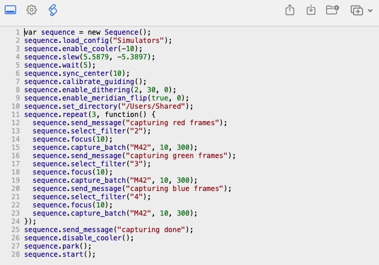
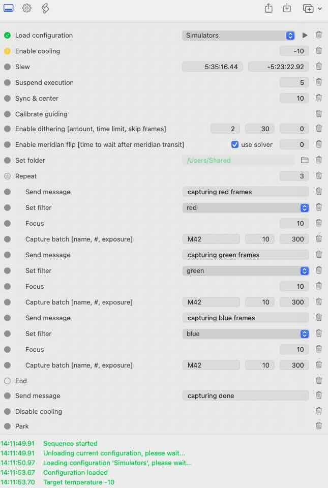

#  INDIGO Script based Sequencer
Revision: 22.11.2026 (draft)

Authors: **Peter Polakovic** & **Rumen G. Bogdanovski**

e-mail: *rumenastro@gmail.com*

## License

INDIGO Astronomy open-source license.

## Overview

The Sequencer is a JavaScript library ([Sequencer.js](Sequencer.js)) executed by the INDIGO **Scripting Agent**. It lets you describe an imaging session - device selection, slewing, focusing, guiding, capturing, meridian flips, etc. - as an ordered list of high level steps and then execute it, while the agent publishes live progress and state as INDIGO properties so a GUI can visualize and control the run.

A sequence is built by creating a `Sequence` object and calling helper methods on it. Each helper call does **not** execute anything immediately - it only appends one (or several) *microsteps* to an internal array. The sequence is executed only when `start()` is called. This two phase design (build, then run) is what allows the GUI to render the whole sequence up front and track which step is currently running.

## Use

Before the first sequence is created, the content of [Sequencer.js](Sequencer.js) must be executed as a script by setting it as the value of `AGENT_SCRIPTING_RUN_SCRIPT_ITEM` in the `AGENT_SCRIPTING_RUN_SCRIPT_PROPERTY` of the Scripting Agent. This defines the `Sequence` class and registers the internal event handlers.

The library may be executed again at any time; clients usually send it before every script they run. A reload keeps a running sequence and an enabled meridian flip, together with their loop and flipper state, and sends the message "Sequencer reloaded, the running sequence continues". Only an idle sequencer is replaced by the reloaded definitions.

## State: under development

## Quick start

```js
var sequence = new Sequence("M42 LRGB");

sequence.load_config("Simulators");
sequence.enable_cooler(-10);
sequence.slew(5.5879, -5.3897);
sequence.wait(5);
sequence.sync_center(10);

sequence.enable_dithering(2, 30, 0);
sequence.enable_meridian_flip(true, 0);

sequence.calibrate_guiding(0.5);
sequence.start_guiding(1.5);
sequence.set_directory("/Users/Shared");

sequence.send_message("capturing luminance frames");
sequence.select_filter("L");
sequence.focus(10);
sequence.capture_batch("M42", 20, 120);

sequence.send_message("capturing red frames");
sequence.select_filter("R");
sequence.focus(10);
sequence.capture_batch("M42", 10, 300);

sequence.send_message("capturing green frames");
sequence.select_filter("G");
sequence.focus(10);
sequence.capture_batch("M42", 10, 300);

sequence.send_message("capturing blue frames");
sequence.select_filter("B");
sequence.focus(10);
sequence.capture_batch("M42", 10, 300);

sequence.send_message("capturing done");
sequence.stop_guiding();
sequence.disable_cooler();
sequence.park();

sequence.start();
```

## Building a sequence

### Creating the sequence

```js
var sequence = new Sequence("Sequence name");
```

The name is optional; if omitted it defaults to an empty string. It is reported to clients in the `SEQUENCE_NAME` property.

### Adding steps

Call helper methods (documented in [Step reference](#step-reference) below) in the order you want them executed:

```js
sequence.select_filter("R");
sequence.focus(10);
sequence.capture_batch("M42", 10, 300);
```

Remember that calling a helper only records the step - nothing is sent to the hardware until `start()` is called.

### Loops

`repeat(count, block)` records a loop. The `block` is an anonymous function containing the loop body; it is expanded (unrolled) `count` times when the sequence is built, so the GUI shows the full progress. Loops may be nested.

```js
sequence.repeat(3, function() {
	sequence.send_message("capturing red frames");
	sequence.select_filter("R");
	sequence.focus(10);
	sequence.capture_batch("M42", 10, 300);
	sequence.send_message("capturing green frames");
	sequence.select_filter("G");
	sequence.focus(10);
	sequence.capture_batch("M42", 10, 300);
	sequence.send_message("capturing blue frames");
	sequence.select_filter("B");
	sequence.focus(10);
	sequence.capture_batch("M42", 10, 300);
});
```

By default the per-step state of the loop body is reset on each iteration so the GUI reflags the steps as they run again. This can be turned off with `disable_reset_loop_content_state()` (and back on with `enable_reset_loop_content_state()`).

### Executing the sequence

```js
sequence.start();
```

`start(imager_agent, mount_agent, guider_agent)` optionally accepts the device names of the agents to drive. When omitted they default to `"Imager Agent"`, `"Mount Agent"` and `"Guider Agent"` respectively:

```js
sequence.start("Imager Agent @ observatory", "Mount Agent @ observatory", "Guider Agent @ observatory");
```

`start()` also selects the solver agent automatically. Solver agents are mutually exclusive on one server, so the `"Platesolver Agent"`, `"Astrometry Agent"` or `"ASTAP Agent"` loaded on the host of the imager agent given to `start()` is used, otherwise the local one, otherwise one loaded on another host. An imager agent which is not loaded does not count, its host is not used. With no solver agent `"Astrometry Agent"` is assumed, on the host of the loaded imager agent, otherwise local. A `select_imager_agent()` step does not change the solver agent. Use the `select_solver_agent()` step to choose another solver agent or one loaded later by the sequence. Every `start()` selects the solver agent again. The selected solver agent is used while it is loaded, also when the imager agent or a solver agent on its host appears later; when it is replaced during the sequence, the solver steps, the abort and the meridian flip select a loaded one again in the same way, and the sequence keeps using the new one.

`estimate()` returns counts of the built sequence for a duration estimate, without starting anything: `{ exposure, frames, operations, waits, unknown }`. `exposure` is the total exposure time and `frames` the number of frames of the capture steps, `operations` the number of slew, centering, focus, guiding start, park, unpark, home and dome steps, `waits` the sum of fixed `wait()` delays in seconds, and `unknown` is true when a `wait_until()` or a sky wait makes the duration unknowable. Steps inside `repeat()` count once per iteration. The Scheduler Agent adds its own overheads per frame and per operation.

## Step reference

All methods below are called on a `Sequence` instance and append one or more steps. Times/exposures are in **seconds**, coordinates in the units used by the corresponding agent (RA in hours, Dec in degrees), unless noted otherwise.

### Flow control & timing

| Method | Description |
|---|---|
| `repeat(count, block)` | Repeat the steps recorded by `block` `count` times (see [Loops](#loops)). |
| `wait(delay)` | Pause the sequence for `delay` seconds. |
| `wait_until(time)` | Block until `time`. If `time` is a string it is treated as a UTC time; otherwise as a local time value. Warns once if the wait would exceed 12 hours. |
| `wait_for_gps()` | Block until the selected GPS device has a fix. |
| `break_at(time)` | Checkpoint: when execution reaches it, if `time` has already passed, skip forward to the next `resume_point()`; otherwise continue. `time` is a UTC time string or a local time number. Typically placed inside a loop to stop capturing after a cutoff time. Warns once if `time` is more than 12 hours ahead. |
| `break_at_ha(limit)` | Checkpoint: if the mount's hour angle is past `limit`, skip forward to the next `resume_point()`; otherwise continue. `limit` is a sexagesimal string or a number in hours. |
| `wait_until_solar_altitude_below(limit)` | Wait until the Sun is below `limit` degrees at the selected site. |
| `wait_until_target_altitude_above(limit, ra, dec)` | Wait until the target at `ra`/`dec` (J2000, RA in hours, Dec in degrees, as `@target` and `slew()`) is above `limit` degrees at the selected site. |
| `break_if_solar_altitude_above(limit)` | Skip to the next `resume_point()` when the Sun is above `limit` degrees. |
| `break_if_target_altitude_below(limit, ra, dec)` | Skip to the next `resume_point()` when the target at `ra`/`dec` (J2000) is below `limit` degrees. |
| `send_message(message)` | Broadcast a human readable message to all clients. |
| `evaluate(code)` | Evaluate an arbitrary snippet of scripting `code` as a step. |
| `enable_verbose()` / `disable_verbose()` | Turn verbose logging of executed steps on/off. |
| `enable_reset_loop_content_state()` / `disable_reset_loop_content_state()` | Control whether loop body step states are reset on each iteration. |

### Failure handling & recovery

By default a failing step aborts the sequence. These steps change that behavior for the steps that follow them:

| Method | Description |
|---|---|
| `abort_on_failure()` | On failure, abort the sequence (the default). |
| `continue_on_failure()` | On failure, log it and continue with the next step. |
| `recover_on_failure()` | On failure, skip **forward** to the next `recovery_point()`, discarding the steps in between. If no recovery point follows the failed step, the sequence ends in the **Alert** state ("no recovery point found"). |
| `recovery_point()` | Mark a point where execution resumes after a failure while `recover_on_failure()` is active. Recovery only ever skips forward, so a recovery point must be placed *after* the steps it is meant to protect. |
| `resume_point()` | Mark a point where execution continues after a `break_at()` / `break_at_ha()` break fires; the steps between the break and this point are skipped. If no resume point follows, the sequence simply finishes ("no resume point found"). |

Every failure is reported by a message. When a failure ends the sequence in the **Alert** state, its reason is also published in `SEQUENCE_FAILURE.MESSAGE`, before the `SEQUENCE_STATE` update that ends the sequence: the reason of the failed step under `abort_on_failure()`, including a failed meridian flip, and the reason of the failure that started the skip under `recover_on_failure()` when no recovery point follows. A failure the sequence continues after, under `continue_on_failure()`, `focus_ignore_failure()` or at a recovery point, leaves `MESSAGE` empty. A sequence aborted by `AGENT_ABORT_PROCESS` also ends in the **Alert** state, with `MESSAGE` empty.

### Configuration & drivers

| Method | Description |
|---|---|
| `load_config(name)` | Load a saved server configuration by `name`. |
| `load_driver(name)` / `unload_driver(name)` | Load / unload a driver by `name`. |

### Selecting agents & devices

The `select_*_agent` methods pick which agent drives each role; the remaining `select_*` methods pick the concrete device each agent should use.

| Method | Description |
|---|---|
| `select_imager_agent(agent)` | Select the imager agent. |
| `select_mount_agent(agent)` | Select the mount agent. |
| `select_guider_agent(agent)` | Select the guider agent. |
| `select_solver_agent(agent)` | Select the solver agent instead of the one selected automatically by `start()`. |
| `select_imager_camera(camera)` | Select the imaging camera. |
| `select_filter_wheel(wheel)` | Select the filter wheel. |
| `select_focuser(focuser)` | Select the focuser. |
| `select_rotator(rotator)` | Select the rotator. |
| `select_mount(mount)` | Select the mount. |
| `select_dome(dome)` | Select the dome. |
| `select_gps(gps)` | Select the GPS device. |
| `select_guider_camera(camera)` | Select the guider camera. |
| `select_guider(guider)` | Select the guiding device (e.g. ST4 / pulse guide output). |

### Camera & exposure setup

| Method | Description |
|---|---|
| `select_frame_type(type)` | Select the frame type (e.g. `"Light"`, `"Dark"`, `"Flat"`, `"Bias"`). |
| `select_image_format(format)` | Select the image format (e.g. `"FITS"`, `"RAW"`, `"XISF"`). |
| `set_frame(left, top, width, height)` | Set a sub-frame (ROI). |
| `reset_frame()` | Reset the frame to full sensor size. |
| `select_camera_mode(mode)` | Select a camera readout/binning mode. |
| `set_gain(value)` | Set camera gain. |
| `set_offset(value)` | Set camera offset. |
| `set_gamma(value)` | Set camera gamma. |
| `enable_cooler(temperature)` | Turn the cooler on and set the target `temperature` (°C). |
| `disable_cooler()` | Turn the cooler off. |

DSLR specific:

| Method | Description |
|---|---|
| `select_program(program)` | Select the DSLR program mode. |
| `select_aperture(aperture)` | Select the DSLR aperture. |
| `select_shutter(shutter)` | Select the DSLR shutter speed. |
| `select_iso(iso)` | Select the DSLR ISO. |

### FITS headers & file naming

| Method | Description |
|---|---|
| `set_fits_header(keyword, value)` | Add or set a custom FITS header `keyword`/`value`. |
| `remove_fits_header(keyword)` | Remove a previously set custom FITS header. |
| `set_directory(directory)` | Set the local directory where captured images are saved. |
| `set_file_template(template)` | Set the file name template for saved images. |
| `set_object_name(name)` | Set the object name used in file naming / headers. |

### Filters

| Method | Description |
|---|---|
| `select_filter(filter)` | Move the filter wheel to the given `filter`. Either the filter **name** (e.g. `"R"`) or the **slot number** (e.g. `"2"`) may be passed. |
| `enable_filter_offsets()` / `disable_filter_offsets()` | Enable/disable automatic application of per-filter focus offsets. |

### Capture

| Method | Description |
|---|---|
| `capture_batch(count, exposure)` | Capture a batch of `count` frames of `exposure` seconds each. |
| `capture_batch(name_template, count, exposure)` | As above, but also set the file name template for this batch. |
| `capture_stream(count, exposure)` | Capture `count` frames in streaming mode, `exposure` seconds each. |
| `capture_stream(name_template, count, exposure)` | As above with a file name template. |
| `start_preview(exposure)` | Start a continuous preview with the given `exposure`. |
| `stop_preview()` | Stop the preview. |

Frames captured by `capture_batch` / `capture_stream` contribute to the `EXPOSURE_TOTAL` estimate reported in the `SEQUENCE_STATE` property.

### Focusing

| Method | Description |
|---|---|
| `set_manual_focuser_mode()` / `set_automatic_focuser_mode()` | Switch the focuser between manual and automatic (autofocus) mode. |
| `focus(exposure)` | Run autofocus using `exposure` second frames. Fails the sequence if focusing fails. |
| `focus_ignore_failure(exposure)` | Same as `focus()` but continues even if focusing fails. |
| `set_focuser_position(position)` | Move the focuser to an absolute `position`. |
| `clear_focuser_selection()` | Clear the focuser star selection. |

### Mount

| Method | Description |
|---|---|
| `slew(ra, dec)` | Slew the mount to the given coordinates (RA in hours, Dec in degrees). |
| `park()` / `unpark()` | Park / unpark the mount. |
| `home()` | Send the mount to its home position. |
| `enable_tracking()` / `disable_tracking()` | Turn sidereal tracking on/off. |
| `enable_ha_limit()` / `disable_ha_limit()` | Enable/disable the Mount Agent hour-angle limit. |
| `enable_time_limit()` / `disable_time_limit()` | Enable/disable the Mount Agent process time limit. |
| `enable_joystick_control()` / `disable_joystick_control()` | Enable/disable Mount Agent joystick control. |

### Dome

| Method | Description |
|---|---|
| `dome_slew(az)` | Slew the dome to the given azimuth in degrees. This step waits until the dome stops moving. |
| `dome_park()` / `dome_unpark()` | Park / unpark the dome. |
| `dome_open()` / `dome_close()` | Open / close the dome shutter. |
| `enable_dome_slaving()` / `disable_dome_slaving()` | Make the dome follow the mount, or stop following it. |
| `make_dome_slaving_persistent()` / `make_dome_slaving_not_persistent()` | Keep dome slaving on across mount processes, or only while one is running. |

### Plate solving & centering

Configure the selected backend using the [solver operating manual](../../../indigo_docs/mcp/agents/platesolver.md). For native algorithms, WCS and indexes, see the [native INDIGO solver reference](https://github.com/indigo-astronomy/indigo/blob/master/indigo_drivers/agent_platesolver/doc/PLATESOLVER.md).

| Method | Description |
|---|---|
| `sync_center(exposure)` | Plate solve using `exposure` second frames and center the current pointing. |
| `set_solver_filter(filter)` | Set the filter the solver selects for its exposures (e.g. in `sync_center()` or `precise_goto()`); the wheel is not moved now, and returns to the previous filter after each solver exposure. Either the filter **name** (e.g. `"L"`) or the **slot number** (e.g. `"1"`) may be passed, `"CURRENT"` or `"0"` solves through whatever filter is selected. |
| `precise_goto(exposure, ra, dec)` | Iteratively slew and plate-solve to precisely reach the target `ra`/`dec`. |

### Guiding

| Method | Description |
|---|---|
| `calibrate_guiding(exposure, step)` | Calibrate the guider. `exposure` and `step` are optional; if given they set the guider exposure and the initial calibration step (s) first. |
| `start_guiding(exposure)` | Start guiding. `exposure` is optional (sets the guider exposure first if given). |
| `stop_guiding()` | Stop guiding. |
| `clear_guider_selection()` | Clear the guide star selection. |

> `start_guiding_exposure(exposure)` is **deprecated** - use `start_guiding(exposure)` instead.

### Dithering

| Method | Description |
|---|---|
| `enable_dithering(amount, time_limit, skip_frames)` | Enable dithering: `amount` in pixels, `time_limit` seconds to wait for settling, `skip_frames` frames to skip between dithers. |
| `disable_dithering()` | Disable dithering. |

### Meridian flip

| Method | Description |
|---|---|
| `enable_meridian_flip(use_solver, time)` | Enable automatic meridian flip. `use_solver` selects whether plate solving is used to recenter after the flip: a number greater than zero is the solver exposure in seconds, which the flip sets on the solver agent's `AGENT_PLATESOLVER_EXPOSURE.EXPOSURE` before it recenters, `true` recenters with the exposure the solver agent has at that time, and `false` or `0` does not recenter; `time` is the pause after transit in hours (for example, `0.25` for 15 minutes; a negative value pauses before transit), passed unchanged to Imager Agent `AGENT_IMAGER_BATCH.PAUSE_AFTER_TRANSIT`. The flip stays enabled after the sequence finishes and recenters with the solver agent loaded at the time of the flip, see `start()`; with no solver agent loaded the flip fails. A failed flip (slew, recentering or guiding) restores the HA limit it disabled and follows the failure policy: the step during which it ran fails, a capture paused by the flip is aborted first, and `continue_on_failure()` or `recover_on_failure()` continue the sequence; under `abort_on_failure()` the sequence and the agents are aborted. After the sequence ended only the agents are aborted, and `SEQUENCE_STATE` and `SEQUENCE_STEP_STATE` keep the result of the sequence, the failure is reported by its message and by `FLIPPER_STATE`. Guiding stopped by the flip is not restarted after a failure, so the steps after a recovery point should start it again. The settings are published by `MERIDIAN_FLIP` when the step executes. |
| `disable_meridian_flip()` | Disable automatic meridian flip. `MERIDIAN_FLIP.ENABLED` becomes `0`, `USE_SOLVER` and `OFFSET` keep the values of the last `enable_meridian_flip()`. |

#### How the meridian flip works

`enable_meridian_flip()` turns on the Imager Agent `AGENT_PROCESS_FEATURES.PAUSE_AFTER_TRANSIT` feature and sets the pause time in `AGENT_IMAGER_BATCH.PAUSE_AFTER_TRANSIT`. The flip itself is then driven by the agents selected for the sequence (see `start()` and the `select_*_agent()` steps), whether a sequence is running or not:

1. The Imager Agent pauses a capture batch before an exposure that would end after the transit shifted by `time`, and reports it by `AGENT_PAUSE_PROCESS` in the **Busy** state with `PAUSE_AFTER_TRANSIT` on. The flip starts: "Meridian flip waits for transit" is sent and `FLIPPER_STATE` becomes **Busy** with `WAITING_FOR_TRANSIT` on.
2. The flip waits until the Mount Agent reports `FLIP_REQUIRED` in `AGENT_MOUNT_DISPLAY_COORDINATES_PROPERTY`. Then "Meridian flip started" is sent.
3. It remembers whether the Guider Agent was guiding (`AGENT_START_PROCESS.CALIBRATION_AND_GUIDING` or `GUIDING` on), which is shown by `FLIPPER_STATE.RESUME_GUIDING`.
4. If the Mount Agent hour-angle limit (`AGENT_PROCESS_FEATURES.ENABLE_HA_LIMIT`) is on, it is turned off for the flip.
5. The mount slews with Mount Agent `AGENT_START_PROCESS.SLEW` (`WAITING_FOR_SLEW`).
6. When recentering with the solver is enabled (`FLIPPER_STATE.USE_SOLVER`), the solver agent loaded at that time is used (see `start()`): when the solver exposure is greater than zero, it is set in `AGENT_PLATESOLVER_EXPOSURE.EXPOSURE`, and the solver agent's `AGENT_START_PROCESS.CENTER` recenters the target (`WAITING_FOR_SYNC_AND_CENTER`).
7. Only when guiding ran before the flip, it is started again with Guider Agent `AGENT_START_PROCESS.GUIDING` (`WAITING_FOR_GUIDING`). When the guider process becomes **Busy**, "Settling down..." is sent, and the flip waits until `AGENT_GUIDER_STATS.FRAME` is greater than 3 (`WAITING_FOR_SETTLE_DOWN`).
8. The HA limit is turned on again if the flip turned it off, the Imager Agent pause is released (`AGENT_PAUSE_PROCESS.PAUSE_AFTER_TRANSIT` off), so the paused batch continues, `FLIPPER_STATE` becomes **Ok** and "Meridian flip finished" is sent.

A failed slew, recentering or guiding start, or a missing solver agent, ends the flip with `FLIPPER_STATE` in the **Alert** state and a "Meridian flip failed (...)" message (see [Meridian flip messages](#meridian-flip-messages)); what happens to the sequence and the agents then is described for `enable_meridian_flip()` above.

### Rotator

| Method | Description |
|---|---|
| `set_rotator_angle(value)` | Rotate the field rotator to the given angle. |
| `enable_field_derotation()` / `disable_field_derotation()` | Enable/disable field derotation in the Mount Agent. |
| `make_field_derotation_persistent()` / `make_field_derotation_not_persistent()` | Keep field derotation enabled across mount processes, or limit it to the current process. |

## Properties published during execution

Once `start()` is called, the sequencer defines the following properties on the **Scripting Agent** device. A GUI reads them to visualize progress and can write to the read-write ones to control the run.

| Property | Type / Perm | Items | Purpose |
|---|---|---|---|
| `SEQUENCE_NAME` | Text, RO | `NAME` | Name of the currently executed sequence (from the `Sequence` constructor), or empty if none/unset. |
| `SEQUENCE_STATE` | Number, RO | `STEP`, `PROGRESS`, `PROGRESS_TOTAL`, `EXPOSURE`, `EXPOSURE_TOTAL` | Overall execution state (see below). |
| `SEQUENCE_FAILURE` | Text, RO | `MESSAGE` | Reason of the failure that ended the sequence in the **Alert** state, published before that `SEQUENCE_STATE` update, see [Failure handling & recovery](#failure-handling--recovery). Updated, empty, by `start()` before the `SEQUENCE_STATE` update that starts a sequence. Empty while a sequence runs, after it finished, after an abort by `AGENT_ABORT_PROCESS` and after `SEQUENCE_RESET`. |
| `SEQUENCE_STEP_STATE` | Light, RO | one item per step | Per-step state, letting the GUI flag each step as idle / busy / ok / alert individually. |
| `LOOP_x` | Number, RO | `STEP`, `COUNT` | One property per currently executing loop, where `x` is the zero-based nesting level. `STEP` is the index of the loop command, `COUNT` the number of completed iterations. |
| `AGENT_ABORT_PROCESS` | Switch, RW | `ABORT` | Setting `ABORT` aborts the running sequence. |
| `AGENT_PAUSE_PROCESS` | Switch, RW | `PAUSE_WAIT` | Pause the sequence before the next operation. |
| `SEQUENCE_RESET` | Switch, RW | `RESET` | Reset the state of `SEQUENCE_STATE` (e.g. while the sequence is being edited in the GUI). |
| `FLIPPER_STATE` | Switch, RO | `WAITING_FOR_TRANSIT`, `WAITING_FOR_SLEW`, `WAITING_FOR_SYNC_AND_CENTER`, `WAITING_FOR_GUIDING`, `WAITING_FOR_SETTLE_DOWN`, `RESUME_GUIDING`, `USE_SOLVER` | Progress of the automatic meridian flip, see [How the meridian flip works](#how-the-meridian-flip-works). `WAITING_FOR_TRANSIT`, `WAITING_FOR_SLEW`, `WAITING_FOR_SYNC_AND_CENTER`, `WAITING_FOR_GUIDING` and `WAITING_FOR_SETTLE_DOWN` show the phase the flip is waiting in: for `FLIP_REQUIRED` from the Mount Agent, for the slew, for recentering with the solver, for the guider process to start and for guiding to settle down. `RESUME_GUIDING` is set when the flip starts the slew ("Meridian flip started"): on when guiding ran then and will be restarted after the flip; before that, also while waiting for transit, it keeps the value of the previous flip. `USE_SOLVER` is on when the flip recenters with the solver. The state is **Busy** during the flip, including the wait for transit, **Ok** when it finished, and **Alert** after a failure; then the `WAITING_FOR_*` item still on shows the phase that failed (slew, recentering or guiding), none is on when no solver agent was loaded. |
| `MERIDIAN_FLIP` | Number, RO | `ENABLED`, `USE_SOLVER`, `OFFSET` | Meridian flip settings, changed only when the steps of `enable_meridian_flip()` and `disable_meridian_flip()` execute. `ENABLED` is `1` when the flip is enabled, `0` otherwise (also before the first of these steps). `USE_SOLVER` is `0` when the flip does not recenter with the solver, otherwise the solver exposure in seconds: the given number, or for `true` the exposure the loaded solver agent had when the step executed, `1` when no solver agent was loaded or its exposure was not positive; it is limited to 0..60 s like the solver agents' `AGENT_PLATESOLVER_EXPOSURE.EXPOSURE`, and a larger number is also set as 60 s by the flip. `OFFSET` is the `time` in hours relative to the meridian (transit): negative before the meridian, positive after it, `0` at the meridian; it is limited to -2..2 h like Imager Agent `AGENT_IMAGER_BATCH.PAUSE_AFTER_TRANSIT`, which uses it. `disable_meridian_flip()` keeps `USE_SOLVER` and `OFFSET` of the last `enable_meridian_flip()`. The settings, including those used by the flip, are kept when clients send the library again, and the property disappears with the Scripting Agent like `FLIPPER_STATE`. |

### Interpreting `SEQUENCE_STATE`

- `STEP` - zero-based index of the currently executing step. On failure (property in **Alert** state) it holds the index of the failed step.
- `PROGRESS` / `PROGRESS_TOTAL` - number of executed microsteps and total number of microsteps in the sequence (with loops unrolled). A single helper call can expand to several microsteps.
- `EXPOSURE` / `EXPOSURE_TOTAL` - elapsed and total exposure time (seconds) across all `capture_batch()` / `capture_stream()` steps.
- Property **state** reflects the sequence: **Ok** = finished, **Busy** = executing, **Alert** = failed or aborted; `SEQUENCE_FAILURE.MESSAGE` holds the reason of a failure and is empty after an abort by `AGENT_ABORT_PROCESS`.

A GUI can use `STEP` together with the property state to flag steps: those with index `< STEP` as done, those with index `> STEP` as idle, and the one equal to `STEP` as either executing (Busy) or failed (Alert). `SEQUENCE_STEP_STATE` provides the same information per step directly.

## Messages

The sequencer reports its progress by messages sent to all clients. In the tables, `<...>` stands for a value filled in when the message is sent.

### Sequence messages

| Message | When |
|---|---|
| `Sequencer installed` | [Sequencer.js](Sequencer.js) is executed for the first time in the Scripting Agent. |
| `Sequencer reloaded, the running sequence continues` | [Sequencer.js](Sequencer.js) is executed again while a sequence runs, see [Use](#use). |
| `Sequence started` | `start()` starts a sequence. |
| `Other sequence is executed` | `start()` is called while another sequence runs; the new sequence is not started. |
| `Sequence finished` | The last step of the sequence completed. |
| `Sequence paused` / `Sequence resumed` | `AGENT_PAUSE_PROCESS.PAUSE_WAIT` of the Scripting Agent is turned on / off while a sequence runs. |
| `<message>` | A `send_message(message)` step executes. |
| `'<device> -> <property> -> <item>' is already selected` / `... is already unselected` | A step selects or deselects a switch item that already has that value; sent only while verbose logging is on (the default, see `enable_verbose()` / `disable_verbose()`), and the step succeeds. |

### Break and wait messages

| Message | When |
|---|---|
| `Possible error - 'wait_until' will block for more than 12 hours!` | Building the sequence, the first `wait_until()` whose time is more than 12 hours ahead. |
| `Possible error - 'break_at' will fire in more than 12 hours!` | Building the sequence, the first `break_at()` whose time is more than 12 hours ahead. |
| `Suspended for <delay>s` | A `wait()` step starts waiting. |
| `Suspended until <time> UTC` | A `wait_until()` step starts waiting. |
| `Target time has passed` | A `wait_until()` step executes after its time; it does not wait. |
| `Waiting for GPS` | A `wait_for_gps()` step finds the GPS coordinates busy and waits for them. |
| `Waiting for solar altitude to drop below <limit>° (currently <altitude>°)` | A `wait_until_solar_altitude_below()` step starts waiting. |
| `Solar altitude <altitude>°, waiting for < <limit>°` | Every 60 s while that step waits. |
| `Solar altitude <altitude>° is already below <limit>°` | That step executes with the Sun already below the limit; it does not wait. |
| `Waiting for target altitude to rise above <limit>° (currently <altitude>°)` | A `wait_until_target_altitude_above()` step starts waiting. |
| `Target altitude <altitude>°, waiting for > <limit>°` | Every 60 s while that step waits. |
| `Target altitude <altitude>° is already above <limit>°` | That step executes with the target already above the limit; it does not wait. |
| `Break executed` | A `break_at()` step executes after its time. |
| `Break executed: HA <ha> past limit <limit>` | A `break_at_ha()` step finds the hour angle past the limit. |
| `Break executed: solar altitude <altitude>° above <limit>°` | A `break_if_solar_altitude_above()` step breaks. |
| `Break executed: target altitude <altitude>° below <limit>°` | A `break_if_target_altitude_below()` step breaks. |
| `Resumed from break at resume point #<index>` | After a break, execution continues at a `resume_point()`. |
| `Sequence finished, no resume point found` | After a break, no `resume_point()` followed; the sequence ends in the **Ok** state. |

### Failure and recovery messages

Each failure sends its reason as a message, whatever the failure policy, see [Failure handling & recovery](#failure-handling--recovery):

| Message | When |
|---|---|
| `<property> reports alert` | A property the step waits for turns to the **Alert** state. |
| `Step failed: <error>` | Executing the step throws an error. |
| `Failed to set '<property>' on '<device>'` | A switch step names a property the device does not have. |
| `There is no <property> on <device>` | A text or number step names a property the device does not have. |
| `Failed to set '<property>', '<device>' is busy` | The property to change is busy and the step does not allow that. |
| `Failed to set non-existent option '<item>' for '<device> -> <property>'` | A switch step names an item which is neither an item name nor an item label of the property. |
| `There is no AGENT_START_PROCESS on <agent>` | `stop_preview()` or `stop_guiding()` finds no `AGENT_START_PROCESS` on the agent. |
| `Can't wait for GPS` | `wait_for_gps()` finds no `GPS_GEOGRAPHIC_COORDINATES` on the Mount Agent. |
| `Can't save batch` | The Imager Agent has no `AGENT_IMAGER_BATCH` to save. |
| `Can't schedule timer in <delay>s` / `Can't schedule timer at <time> UTC` | The timer of a `wait()` / `wait_until()` step can't be scheduled. |
| `Recovered from failure at recovery point #<index>` | Under `recover_on_failure()`, execution continues at a `recovery_point()` after a failure. |
| `Sequence failed, no recovery point found` | Under `recover_on_failure()`, no `recovery_point()` followed the failure; the sequence ends in the **Alert** state. |

Two `SEQUENCE_STATE` updates to the **Alert** state also carry a message: `Sequence failed` when a step fails under `abort_on_failure()`, and `Sequence aborted` when a running sequence is aborted by `AGENT_ABORT_PROCESS` or by a failed meridian flip under `abort_on_failure()`. The **Alert** update after `recover_on_failure()` finds no recovery point carries none.

### Meridian flip messages

| Message | When |
|---|---|
| `Meridian flip waits for transit` | The Imager Agent paused the batch for transit and the flip starts waiting for `FLIP_REQUIRED`. |
| `Meridian flip started` | The Mount Agent reports `FLIP_REQUIRED`; the flip slews. |
| `Settling down...` | Guiding restarted after the flip; the flip waits for it to settle down. |
| `Meridian flip finished` | The flip completed and the Imager Agent pause is released. |
| `Meridian flip failed (due to slew failure)` | The Mount Agent slew ends in the **Alert** state. |
| `Meridian flip failed (no solver agent is loaded)` | Recentering is enabled but no solver agent is loaded after the slew. |
| `Meridian flip failed (due to sync & center failure)` | Recentering with the solver ends in the **Alert** state. |
| `Meridian flip failed (due to guiding failure)` | Restarting guiding ends in the **Alert** state. |

A `Meridian flip failed (...)` message is also the failure reason handled by the failure policy, see `enable_meridian_flip()` in [Meridian flip](#meridian-flip). Under `continue_on_failure()` or `recover_on_failure()` with a running sequence, it is sent when the step during which the flip ran ends, or at once when that step is a `wait()`, `wait_until()` or altitude wait.

## Internal implementation

Besides the public `Sequence` class, [Sequencer.js](Sequencer.js) contains two internal singletons that users normally do not call directly:

- `indigo_sequencer` - the execution engine. It interprets the recorded microsteps one by one, waits for the relevant agent properties to reach the expected state, updates the progress properties, and handles abort/pause/failure logic.
- `indigo_flipper` - the meridian-flip state machine. `indigo_sequencer` starts it when the Imager Agent pauses for transit; it performs the steps described in [How the meridian flip works](#how-the-meridian-flip-works), reports progress via `FLIPPER_STATE`, and hands a failure to `indigo_sequencer`, which applies the failure policy.

These are wired into the agent through `indigo_event_handlers` and respond to `on_update` / `on_enumerate_properties` events. Refer to [Sequencer.js](Sequencer.js) for the details.

## Examples of visual representation of a sequence in GUI (pre-release of INDIGO A1v5)

 

 
